# TechieBlog — Developer Guide

| | |
|---|---|
| App | TechieBlog |
| Kind | app |
| Size | Large |
| Phase | 1 of 1 |
| Verified on | 2026-11-02 |
| Date | 2026-11-02 |

Runtime-verified on 2026-11-02: the web host (published copy, WSL side) signed in as all four test users plus anonymous, and the BlogApp desktop head over its WebView2 DevTools port. Screenshots: `docs/screenshots/TechieBlog/`. Line numbers are as of that date; search for the function name when a line has moved.

## Architecture cheat-sheet

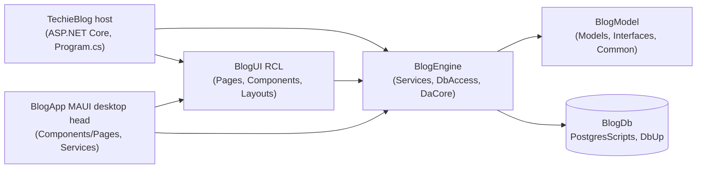

| Layer | Project or folder | What lives here |
|---|---|---|
| Host | `source/TechieBlog` (`Program.cs`, `Middleware/`, `Observability/`, `Configuration/`) | startup, DI, DbUp call, Serilog, pipeline, health checks |
| BlogUI | `source/BlogUI` (`Pages/AdminPages/`, `Pages/BlogPages/`, `Components/`, `Layouts/`) | Razor pages and layouts (`MainLayout`, `AdminLayout`) |
| BlogEngine | `source/BlogEngine` (`Services/`, `DbAccess/`, `DaCore/`, `Common/`, `Storage/`) | services (`BlogSvc`, `UserStatsSvc`, `AuthSvc`), Dapper repos, cache |
| BlogModel | `source/BlogModel` (`Models/`, `Interfaces/`, `Common/`) | entities (assembly `BlogModels`), repo interfaces, `AppSecrets` |
| BlogDb | `source/BlogDb` (`BlogDbSvc.cs`, `MigrationRunner.cs`, `PostgresScripts/`) | DbUp migration engine and SQL scripts |
| BlogApp | `source/BlogApp` (`Components/Pages/`, `Services/`, `MauiProgram.cs`, `Platforms/`) | MAUI Blazor Hybrid head, `ConnectionStore`, probes |

## Roles and menu map

| Role | Test user | Lands on | Menu |
|---|---|---|---|
| Guest | 6 (anonymous) | `/` | public site menu below |
| Contributor | 4 `contributor@techieblog.test` | `/` | public menu only; `/admin` → `/access-denied` |
| Author | 3 `author@techieblog.test` | `/BlogsList` | admin menu items marked `AuthorOrAbove` |
| Editor | 2 `editor@techieblog.test` | `/admin` | `AuthorOrAbove` + `EditorOrAbove` items |
| Admin | 1 `Ravi@techieblog.com` | `/admin` | every item |

Landing routes observed at sign-in on 2026-11-02.

### Public site menu

Public layout: `source/BlogUI/Layouts/MainLayout.razor` renders `<Header />` (`:18`) and `<Footer />` (`:30`).

Header (`source/BlogUI/Components/Header.razor:217-222`, `NavLinks`):

| Label | Route | Line |
|---|---|---|
| Home | `/` | 217 |
| Categories | `/categories` | 218 |
| Series | `/series` | 219 |
| Newsletter | `/newsletters` | 220 |
| Resume | `/resume` | 221 |
| Speaking | `/speaker-profile` | 222 |

Other header links: brand `/` (`Header.razor:43`), search `/search` (`:242`). About is deliberately left out of the header (comment at `Header.razor:223-225`).

Footer (`source/BlogUI/Components/Footer.razor:26-30`): About `/about` (:26), Resume `/resume` (:27), Categories `/categories` (:28), Series `/series` (:29), RSS `/rss` (:30).

### Admin menu

Source: `source/BlogUI/Layouts/AdminLayout.razor.cs`, `NavGroups` (lines 95-132). The Dashboard entry sits in markup at `source/BlogUI/Layouts/AdminLayout.razor:67-70`, and each group is filtered by `BuildVisibleGroups` (line 277) with `AppPolicies.IsSatisfiedBy`. Policy constants: `source/BlogModel/Common/AppRoles.cs:117-127`.

- **Dashboard** (no group). `/admin`. `EditorOrAbove`. Markup at `AdminLayout.razor:67-70`.
- **Content**
  - Posts: `/BlogsList`. `AuthorOrAbove`. `AdminLayout.razor.cs:99`.
  - Series: `/admin/series`. `AuthorOrAbove`. `AdminLayout.razor.cs:100`.
  - Comments: `/CommentsList`. `EditorOrAbove`. `AdminLayout.razor.cs:101`.
- **Taxonomy**
  - Categories: `/admin/categories`. `AdminOnly`. `AdminLayout.razor.cs:105`.
  - Tags: `/admin/tags`. `AdminOnly`. `AdminLayout.razor.cs:106`.
- **Media**
  - Images: `/admin/images`. `AdminOnly`. `AdminLayout.razor.cs:110`.
- **Resume**
  - My Profile: `/admin/profile`. `AuthorOrAbove`. `AdminLayout.razor.cs:114`.
  - Experience: `/admin/experience`. `AuthorOrAbove`. `AdminLayout.razor.cs:115`.
  - Skills: `/admin/skills`. `AuthorOrAbove`. `AdminLayout.razor.cs:116`.
  - Awards: `/admin/awards`. `AuthorOrAbove`. `AdminLayout.razor.cs:117`.
  - Statistics: `/admin/stats`. `AuthorOrAbove`. `AdminLayout.razor.cs:118`.
  - Speaking: `/admin/speaking`. `EditorOrAbove`. `AdminLayout.razor.cs:119`.
- **Audience**
  - Users: `/users`. `AdminOnly`. `AdminLayout.razor.cs:123`.
  - Subscribers: `/admin/subscribers`. `AdminOnly`. `AdminLayout.razor.cs:124`.
  - Newsletter: `/admin/newsletter`. `AdminOnly`. `AdminLayout.razor.cs:125`.
  - Analytics: `/admin/analytics`. `EditorOrAbove`. `AdminLayout.razor.cs:126`.
- **System**
  - Settings: `/settings`. `AdminOnly`. `AdminLayout.razor.cs:130`.

Checked against the page attributes: every nav entry's policy matches its page's `@attribute [Authorize]` (for example `BlogsList.razor:14`, `SeriesList.razor:12`, `ManageSpeaking.razor:15` = `EditorOrAbove`, `ManageImages.razor:11` = `AdminOnly`). The Dashboard entry's policy matches `AdminDashboard.razor:13`. The layout's comment (`AdminLayout.razor.cs:90-93`) records the Categories, Tags and Images moves to `AdminOnly`.

## Screen-by-screen code map

All public screens are anonymous; no public page carries `@attribute [Authorize]`.

### Home (`/`)

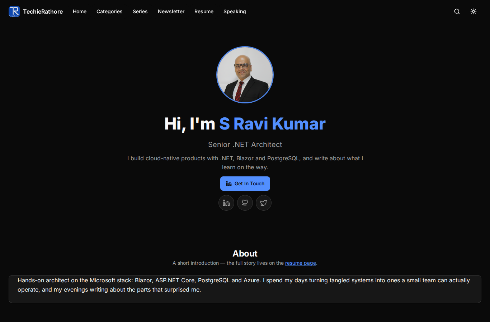
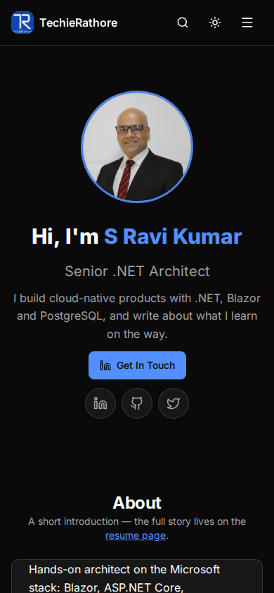

**Runtime:** renders. Seen 2026-11-02, anonymous: owner hero, featured card, latest posts. At 390 px wide: no horizontal overflow.

**Roles:** public

**Call chain:** `Home.razor.cs:OnInitializedAsync` → `BlogSvc.GetPublishedPostsAsync` → `BlogPostRepo.GetPublishedPostsAsync` → `SelectPublishedSql` (`BlogPost` JOIN `BlogUser`); featured block: `BlogSvc.GetFeaturedPostAsync` → `BlogPostRepo.GetFeaturedPostAsync` → `SelectFeaturedSql` (`BlogPost`, `LIMIT 1`); owner: `BlogUserRepo.GetSiteOwnerAsync` → `SelectSiteOwnerSql` (`BlogUser`)

| File and line | Function | Watch | Expected value |
|---|---|---|---|
| `source/BlogUI/Pages/BlogPages/Home.razor.cs:149` | `LoadLatestPostsAsync` | `latestPosts` | up to 3 published posts, newest first |
| `source/BlogUI/Pages/BlogPages/Home.razor.cs:173` | `LoadFeaturedPostAsync` | `featuredPost` | newest published, non-deleted post (`COALESCE(PublishedOn, CreatedOn) DESC`) |
| `source/BlogUI/Pages/BlogPages/Home.razor.cs:124` | `LoadStatsAsync` | `ownerStats` | owner's `userstats` rows, first 4 by `DisplayOrder` |
| `source/BlogUI/Pages/BlogPages/Home.razor:81` | markup | `featuredPost.Slug` | link to `/post/{slug}` |
| `source/BlogEngine/DbAccess/BlogPostRepo.cs:243` | `SelectFeaturedSql` | `PublishedOn` | selected, so the card date is the publish date |

**Calculations on this screen:** `FeaturedExcerpt` (`Home.razor.cs:188`) uses `Abstract`, else strips `# * _ `` from `PostContent` and truncates to 220 characters; `ReadingTimeCalculator.Calculate` for the read time.

### Post view (`/post/{slug}`, alias `/post/{slug}/{pageNumber}`)

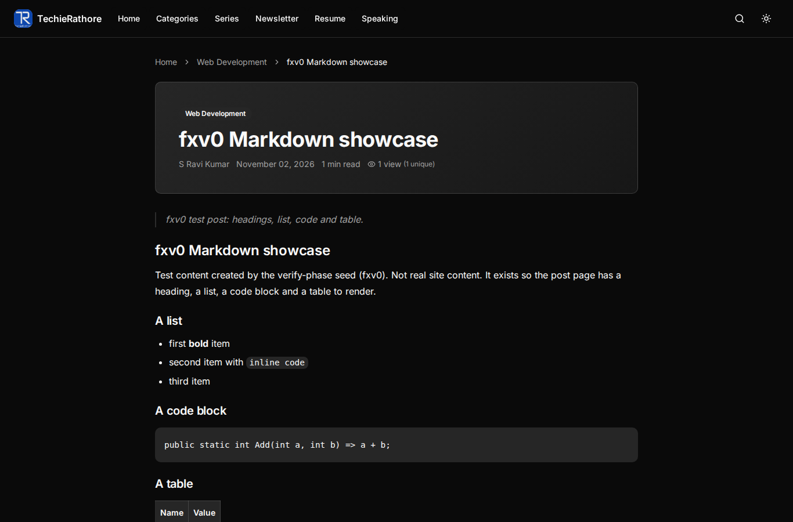
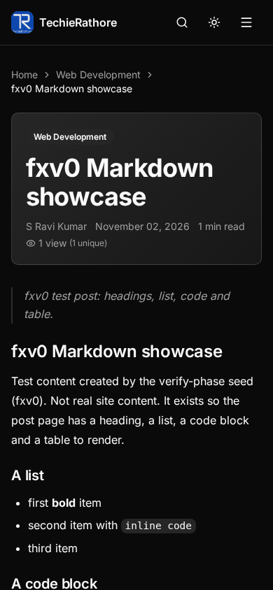

**Runtime:** renders. Seen 2026-11-02, anonymous: Markdown heading, list, code block and table; byline with category, read time, view count. At 390 px: no horizontal overflow.

**Roles:** public

**Call chain:** `PostView.razor:LoadPost` → `BlogSvc.GetPostBySlugAsync` → `BlogPostRepo.GetBySlugAsync` → `SelectBySlugSql` (`BlogPost` LEFT JOIN `BlogUser`, LEFT JOIN `BlogSeries`); comments: `CommentSvc.GetCommentsByPostIdAsync` → `BlogCommentRepo.GetAllByIdAsync` → `blogcomment` (approved only); byline: `AnalyticsSvc.GetPostViewCountsAsync` → `PostViewRepo` → `PostViewCount`

| File and line | Function | Watch | Expected value |
|---|---|---|---|
| `source/BlogUI/Pages/BlogPages/PostView.razor:450` | `LoadPost` | `blogPost` | the post by slug; `notFound` when missing or unpublished |
| `source/BlogUI/Pages/BlogPages/PostView.razor:597` | `LoadCommentsAsync` | `comments` | approved parent comments with their approved replies |
| `source/BlogUI/Pages/BlogPages/PostView.razor:570` | `TrackVisitAndReadCountsAsync` | `viewCounts.TotalViews` | rollup count; a new visit is queued, not written inline |
| `source/BlogUI/Components/CommentForm.razor:213` | `OnSubmitAsync` → `CommentSvc.SubmitCommentAsync` (`CommentSvc.cs:146`) | `result` | captcha and spam gate pass, email verification issued, row inserted as `PendingVerification`; not shown until confirmed and approved |
| `source/BlogUI/Components/PostRatingPanel.razor:226` | `OnSubmitAsync` → `RatingSvc.SubmitRatingAsync` (`RatingSvc.cs:156`) | `result` | captcha passes, `PostRating` upserted by email (`PostRatingRepo.cs:243`), verification issued if unverified |

**Calculations on this screen:** reading time via `ReadingTimeCalculator`; pagination splits `PostContent` at `paginationWordCount` (`PostView.razor:642`); `GetCommentTotal` counts comments plus replies.

### Category archive (`/category/{slug}`, aliases `/categories`, `/categories/{slug}`)

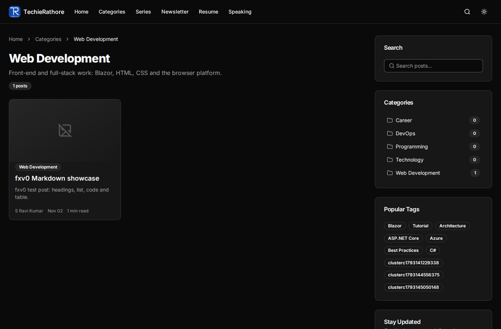

**Runtime:** renders. Seen 2026-11-02, anonymous, `/category/web-development`.

**Roles:** public

**Call chain:** `CategoryArchive.razor:LoadCategory` → `CategorySvc.GetCategoryBySlugAsync` (`CategorySvc.cs:200`) → `CategoryRepo` → `Category`; posts: `BlogSvc.GetPostsByCategoryAsync` → `BlogPostRepo.GetPostsByCategoryAsync` → `SelectByCategorySql`; count: `BlogPostRepo.GetPostCountByCategoryAsync` → `CountByCategorySql`

| File and line | Function | Watch | Expected value |
|---|---|---|---|
| `source/BlogUI/Pages/BlogPages/CategoryArchive.razor:198` | `LoadCategory` | `category` | category by slug; `notFound` when null |
| `source/BlogUI/Pages/BlogPages/CategoryArchive.razor:213` | `LoadCategory` | `totalPosts` | published post count for the category |
| `source/BlogUI/Pages/BlogPages/CategoryArchive.razor:217` | `LoadCategory` | `posts` | one page, `PostsPerPage` (from `SiteSettingsService`, line 179), newest first |
| `source/BlogUI/Pages/BlogPages/CategoryArchive.razor:187` | `LoadCategory` (no slug) | `allCategories` | `CategorySvc.GetAllWithCountsAsync` (`CategoryRepo` LEFT JOIN `BlogPost`) |

**Calculations on this screen:** `totalPages = ceil(totalPosts / PageSize)` (`CategoryArchive.razor:214`); excerpt is `Abstract` or the first 150 characters of `PostContent`.

### Tag archive (`/tag/{slug}`, aliases `/tags`, `/tags/{slug}`)

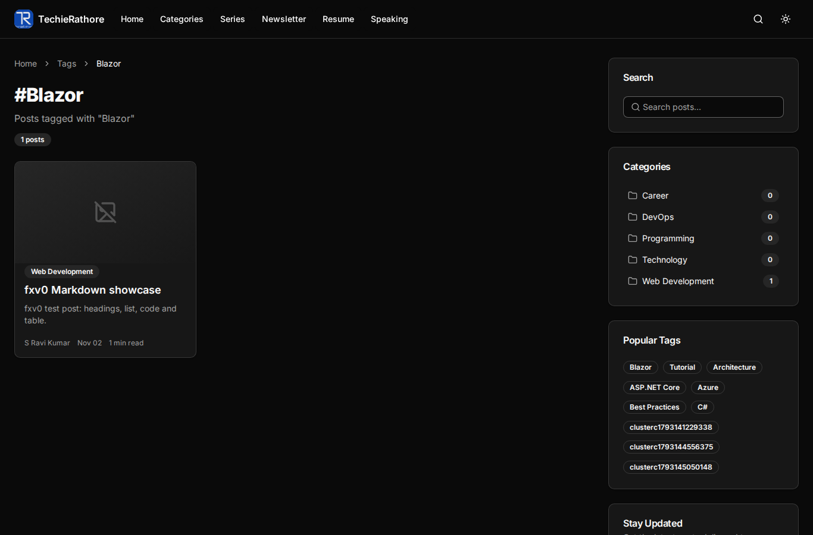

**Runtime:** renders. Seen 2026-11-02, anonymous, `/tag/blazor`.

**Roles:** public

**Call chain:** `TagArchive.razor:LoadTag` → `TagSvc.GetTagBySlugAsync` (`TagSvc.cs:226`) → `BlogTagRepo.GetBySlugAsync` → `Tag`; posts: `TagSvc.GetPostsByTagAsync` → `BlogTagRepo` → `PostTag` JOIN `BlogPost`; cloud: `TagSvc.GetAllWithCountsAsync` → `BlogTagRepo.GetAllWithCountsAsync` (`BlogTagRepo.cs:40`)

| File and line | Function | Watch | Expected value |
|---|---|---|---|
| `source/BlogUI/Pages/BlogPages/TagArchive.razor:197` | `LoadTag` | `tagInfo` | tag by slug; `notFound` when null |
| `source/BlogUI/Pages/BlogPages/TagArchive.razor:212` | `LoadTag` | `totalPosts` | published posts carrying the tag |
| `source/BlogUI/Pages/BlogPages/TagArchive.razor:216` | `LoadTag` | `posts` | one page of published posts with the tag |
| `source/BlogUI/Pages/BlogPages/TagArchive.razor:186` | `LoadTag` (no slug) | `allTags` | every tag with its `PostCount`; font size from `GetTagSizeClass` (line 285) |

**Calculations on this screen:** `GetTagSizeClass` buckets `count` into `text-sm` to `text-xl` by ratio to min and max `PostCount`; `totalPages` as on the category archive.

### Series list and series view (`/series`, `/series/{slug}`)

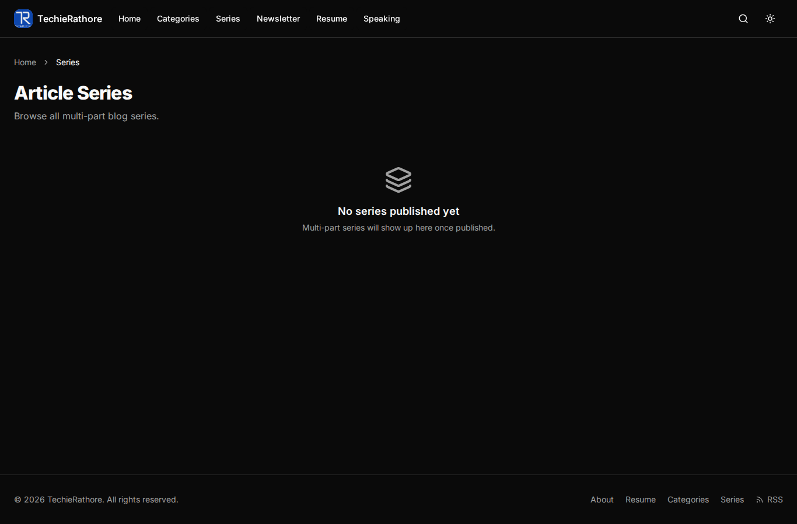
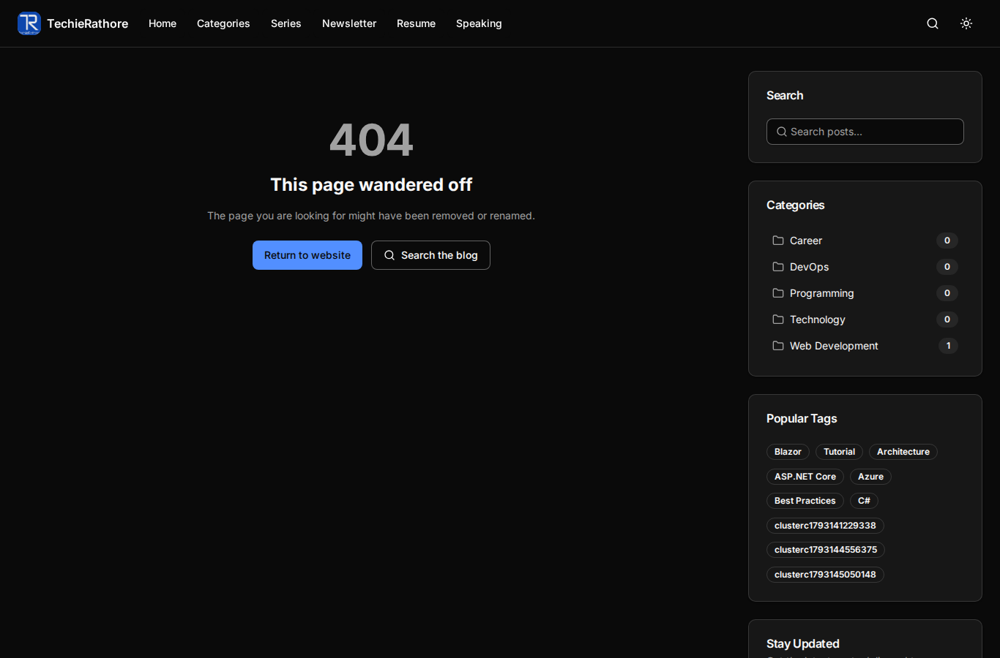

**Runtime:** renders empty. Seen 2026-11-02: this database has 0 series; `/series/{slug}` for an unknown slug shows the not-found page.

**Roles:** public (content managers Admin, Editor, Author also see draft parts, `SeriesView.razor:280`)

**Call chain:** `SeriesView.razor:OnParametersSetAsync` → `IsContentManagerAsync` → `LoadDataAsync` → `SeriesSvc.GetAllWithCountsAsync` (list); `SeriesSvc.GetSeriesBySlugAsync(slug, includeDrafts)` (`SeriesSvc.cs:270`) → `BlogPostRepo.GetPublishedPostsBySeriesAsync` → `SelectPublishedBySeriesSql` (anonymous) or `BlogPostRepo.GetPostsBySeriesAsync` → `SelectBySeriesSql` (content manager)

| File and line | Function | Watch | Expected value |
|---|---|---|---|
| `source/BlogUI/Pages/BlogPages/SeriesView.razor:309` | `LoadDataAsync` | `allSeries` | every series with its `PostCount` (`{unresolved — count basis not traced}`) |
| `source/BlogUI/Pages/BlogPages/SeriesView.razor:315` | `LoadDataAsync` | `series` | series by slug; `SeriesId == 0` shows "Series not found" |
| `source/BlogEngine/Services/SeriesSvc.cs:284` | `GetSeriesBySlugAsync` | `parts` | draft parts only when `includeDrafts` is true |
| `source/BlogUI/Pages/BlogPages/SeriesView.razor:322` | `LoadDataAsync` | `otherSeries` | up to 3 other series |
| `source/BlogUI/Pages/BlogPages/SeriesView.razor:141` | markup | `isLatest` | the newest published part is marked "Latest" |

**Calculations on this screen:** `isLatest` = newest `PublishedOn` among published parts; `Started` is `series.CreatedOn` in `MMM yyyy`.

### Search results (`/search`)

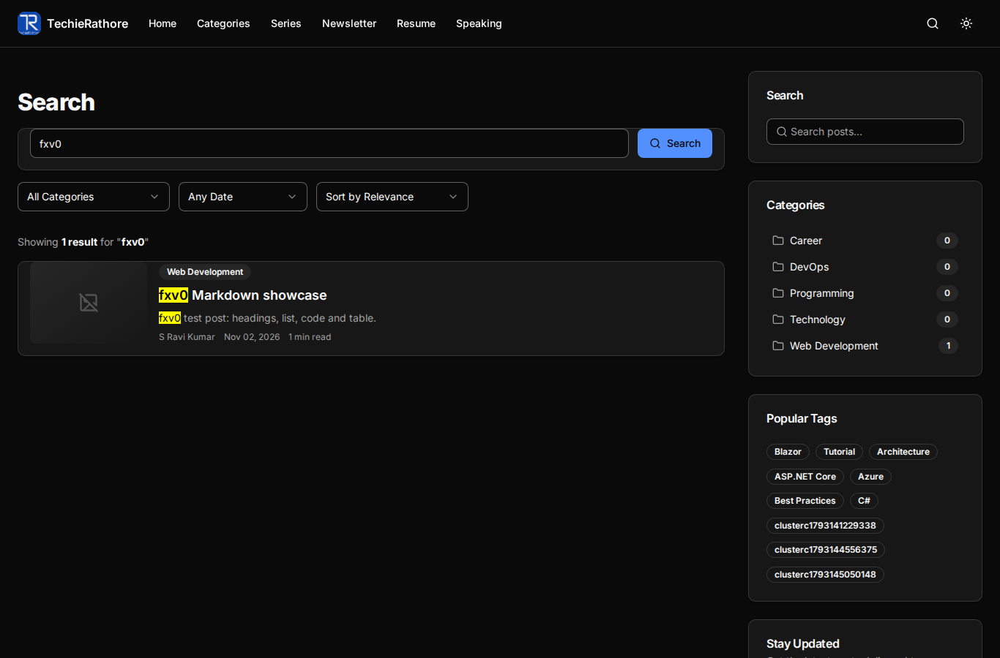

**Runtime:** renders. Seen 2026-11-02, anonymous, `/search?q=fxv0`.

**Roles:** public

**Call chain:** `SearchResults.razor:OnInitializedAsync` → `CategorySvc.GetAllCategoriesAsync` (filter list); `PerformSearchAsync` → `BlogSvc.GetSearchResultCountAsync` → `BlogPostRepo.GetSearchResultCountAsync` → `SearchCountSql`; `BlogSvc.SearchPostsAsync` (`BlogSvc.cs:975`) → `BlogPostRepo.SearchPostsAsync` → `SearchSql` (`BlogPost` ILIKE on Title, Abstract, PostContent, Tags, PostTag/Tag names)

| File and line | Function | Watch | Expected value |
|---|---|---|---|
| `source/BlogUI/Pages/BlogPages/SearchResults.razor:268` | `PerformSearchAsync` | `totalResults` | published matches for `%query%` |
| `source/BlogUI/Pages/BlogPages/SearchResults.razor:272` | `PerformSearchAsync` | `posts` | one page, newest first (`COALESCE(PublishedOn, CreatedOn) DESC`) |
| `source/BlogUI/Pages/BlogPages/SearchResults.razor:289` | `PerformSearchAsync` | `Rating` | intended: the post's star rating |
| `source/BlogUI/Pages/BlogPages/SearchResults.razor:43` | markup | `categoryFilter` | intended: narrows results by category |

**Calculations on this screen:** `HighlightSearchTerms` wraps matching words in `<mark>` after HTML-encoding (`SearchResults.razor:335`); excerpt capped at 200 characters, title at 160; `EstimateReadTime` via `ReadingTimeCalculator`.

### About (`/about`)

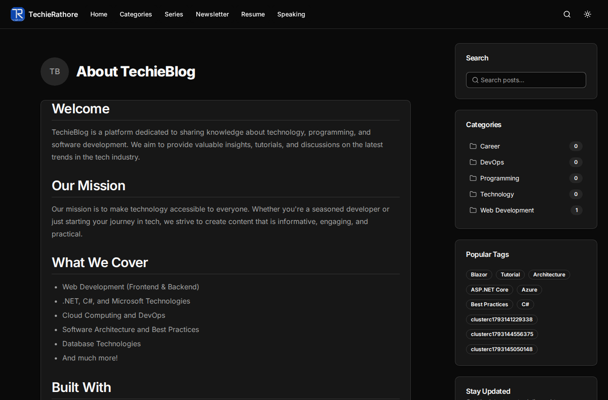

**Runtime:** renders. Seen 2026-11-02, anonymous.

**Roles:** public

**Call chain:** none (static markup; `StackChips` is a constant array, `About.razor:117`)

| File and line | Function | Watch | Expected value |
|---|---|---|---|
| `source/BlogUI/Pages/BlogPages/About.razor:117` | `StackChips` | `StackChips.Length` | 7 technology badges |
| `source/BlogUI/Pages/BlogPages/About.razor:81` | markup | `about-github` link | points to `https://github.com` (generic, not the owner's profile) |
| `source/BlogUI/Pages/BlogPages/About.razor:102` | markup | `about-resume` link | `/resume` |

**Calculations on this screen:** none

### Not found (`/404`)

**Runtime:** renders. Seen 2026-11-02, anonymous: "This page wandered off".

**Roles:** public

**Call chain:** none (static markup). Reached for any unmatched URL by `UseStatusCodePagesWithReExecute(NotFoundPage.Path)` (`source/TechieBlog/Program.cs:620`), which keeps HTTP 404.

| File and line | Function | Watch | Expected value |
|---|---|---|---|
| `source/BlogUI/Pages/AdminPages/404Page.razor:46` | `@page "/404"` | route | the only route for this page; renaming it breaks the re-execution |
| `source/TechieBlog/Program.cs:620` | `UseStatusCodePagesWithReExecute` | status | HTTP 404 with this page rendered |

**Calculations on this screen:** none

### Resume (`/resume`)

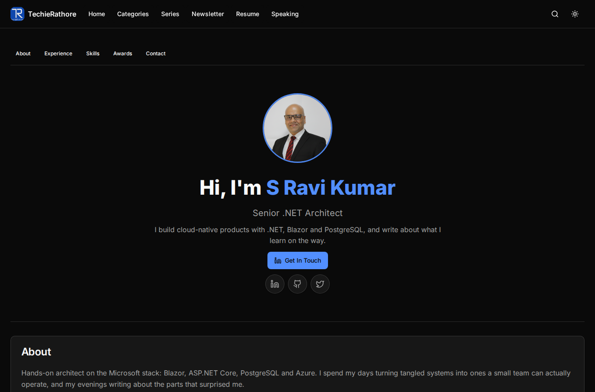

**Runtime:** renders. Seen 2026-11-02, anonymous: site owner hero and sections.

**Roles:** public

**Call chain:** `ResumePage.razor.cs:OnInitializedAsync` → `LoadSiteOwner` → `BlogUserRepo.GetSiteOwnerAsync` (`BlogUserRepo.cs:383`) → `SelectSiteOwnerSql` (`BlogUser`); child sections (`ResumeExperience`, `ResumeSkills`, `ResumeAwards`, `ResumeStats`) `{unresolved — not traced in this pass}`

| File and line | Function | Watch | Expected value |
|---|---|---|---|
| `source/BlogUI/Pages/ResumePage.razor.cs:47` | `LoadSiteOwner` | `siteOwner` | the `IsSiteOwner` user; null renders "Resume not available" |
| `source/BlogUI/Pages/ResumePage.razor:41` | markup | `siteOwner.ResumeEnabled` | false renders "Resume not published" |
| `source/BlogUI/Components/Resume/ResumeHero.razor:81` | markup | `User.CVFilePath` | non-blank shows "Download CV" with `href` = stored path |

**Calculations on this screen:** none

### Speaker profile (`/speaker-profile`)

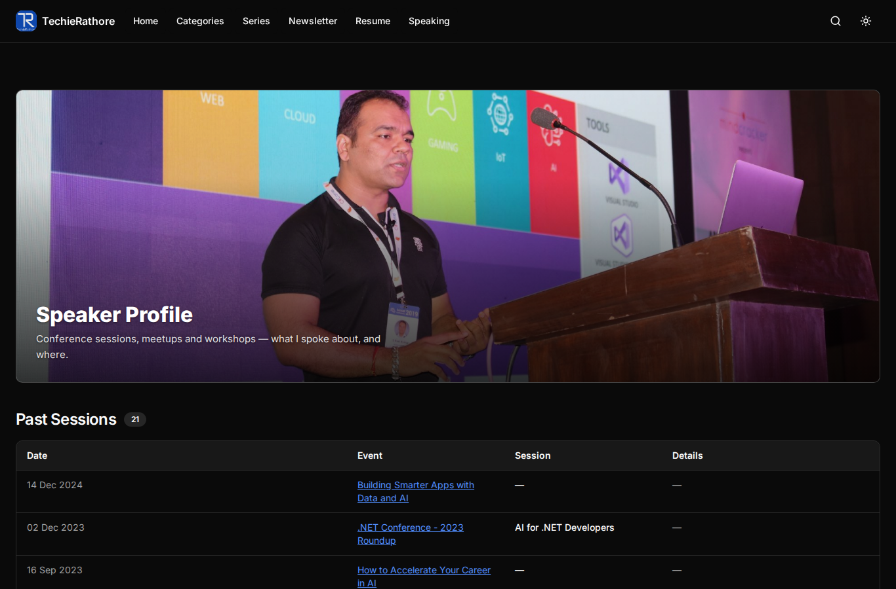

**Runtime:** renders. Seen 2026-11-02, anonymous.

**Roles:** public

**Call chain:** `SpeakerProfile.razor:OnInitializedAsync` → `LoadSessionsAsync` → `BlogUserRepo.GetSiteOwnerAsync` → `SelectSiteOwnerSql` (`BlogUser`); `UserEventRepo.GetByUserAndTypeAsync` (`UserEventRepo.cs:159`) → `userevents` filtered by type `Speaking`

| File and line | Function | Watch | Expected value |
|---|---|---|---|
| `source/BlogUI/Pages/BlogPages/SpeakerProfile.razor:238` | `LoadSessionsAsync` | `sessions` | owner's `Speaking` rows |
| `source/BlogUI/Pages/BlogPages/SpeakerProfile.razor:241` | `LoadSessionsAsync` | `upcomingSessions` | `IsUpcoming` rows (`UserEvent.cs:133`), soonest first |
| `source/BlogUI/Pages/BlogPages/SpeakerProfile.razor:246` | `LoadSessionsAsync` | `pastSessions` | the rest, newest first |
| `source/BlogUI/Pages/BlogPages/SpeakerProfile.razor:84` | markup | `upcomingSessions.Count` | section omitted when zero |

**Calculations on this screen:** `IsUpcoming` is `EventDate.Date >= DateTime.Today` (not a stored flag); `FormatDate` shows "dd MMM yyyy".

### Newsletter archive (`/newsletters`)

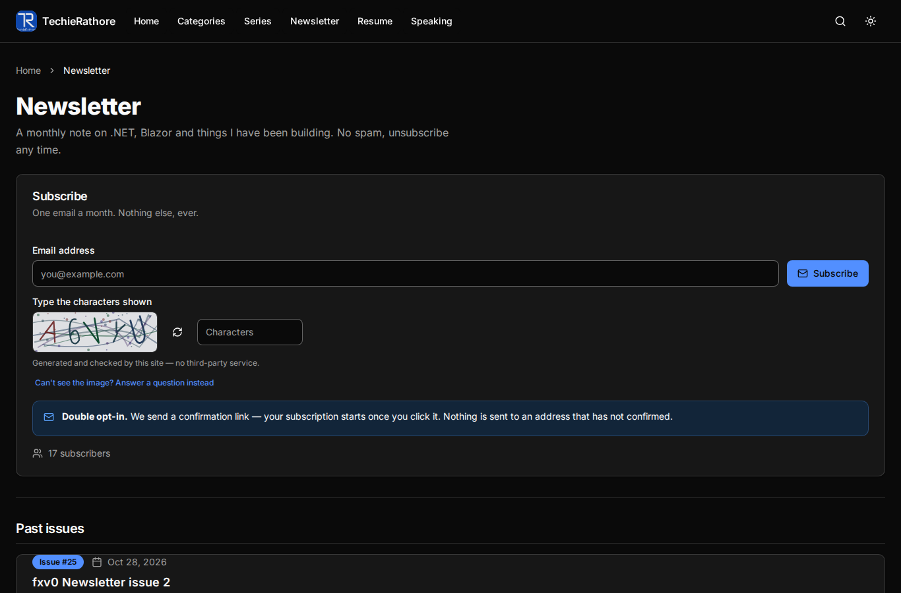

**Runtime:** renders. Seen 2026-11-02, anonymous: archive of sent issues.

**Roles:** public

**Call chain:** `Newsletters.razor.cs:OnInitializedAsync` → `SubscriberRepo.GetActiveSubscribersAsync` → `Subscriber`; `LoadPageAsync` → `NewsletterSvc.GetPublishedIssuesAsync` (`NewsletterSvc.cs:392`) → `{unresolved — NewsletterRepo SQL not read}`

| File and line | Function | Watch | Expected value |
|---|---|---|---|
| `source/BlogUI/Pages/BlogPages/Newsletters.razor.cs:124` | `LoadSubscriberCountAsync` | `confirmedSubscriberCount` | count of active subscribers; 0 on failure |
| `source/BlogUI/Pages/BlogPages/Newsletters.razor.cs:98` | `LoadPageAsync` | `archivePage.Items` | sent, public, slugged issues, newest first |
| `source/BlogUI/Pages/BlogPages/Newsletters.razor.cs:157` | `BuildIssueNumbers` | `numbers[...]` | `TotalCount - firstIndex - offset` (oldest is 1) |

**Calculations on this screen:** issue number is the send-order rank (`BuildIssueNumbers`, line 150); excerpt is `Summary` or the first 200 characters of stripped `Content` (`GetExcerpt`, line 195).

### Newsletter issue (`/newsletter/{slug}`)

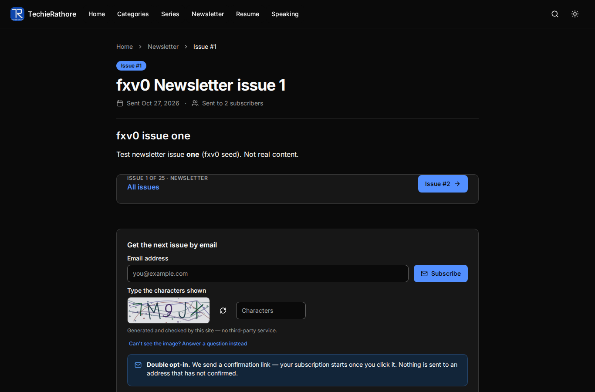

**Runtime:** renders. Seen 2026-11-02, anonymous, `/newsletter/fxv0-newsletter-issue-1`.

**Roles:** public

**Call chain:** `NewsletterView.razor.cs:OnParametersSetAsync` → `LoadIssueAsync` → `NewsletterSvc.GetPublishedBySlugAsync` (`NewsletterSvc.cs:428`) → `{unresolved — NewsletterRepo SQL not read}`; prev/next: `NewsletterSvc.GetNavigationAsync`; rank: `ResolveIssueNumberAsync` (`NewsletterView.razor.cs:138`) pages `GetPublishedIssuesAsync`

| File and line | Function | Watch | Expected value |
|---|---|---|---|
| `source/BlogUI/Pages/BlogPages/NewsletterView.razor.cs:105` | `LoadIssueAsync` | `resolved` | sent, public issue; failure calls `Navigation.NotFound()` (line 109) |
| `source/BlogUI/Pages/BlogPages/NewsletterView.razor.cs:114` | `LoadIssueAsync` | `renderedBody` | `MarkdownRenderer.ToHtml(issue.Content)` |
| `source/BlogUI/Pages/BlogPages/NewsletterView.razor.cs:115` | `LoadIssueAsync` | `navigation` | previous and next issues by send time |
| `source/BlogUI/Pages/BlogPages/NewsletterView.razor.cs:161` | `ResolveIssueNumberAsync` | `issueNumber` | rank by send order; `totalIssues` if scan bound is hit |

**Calculations on this screen:** `issueNumber` rank (line 161); previous/next labels are `issueNumber ∓ 1`.

### Email confirmation (`/verify/{token}`)

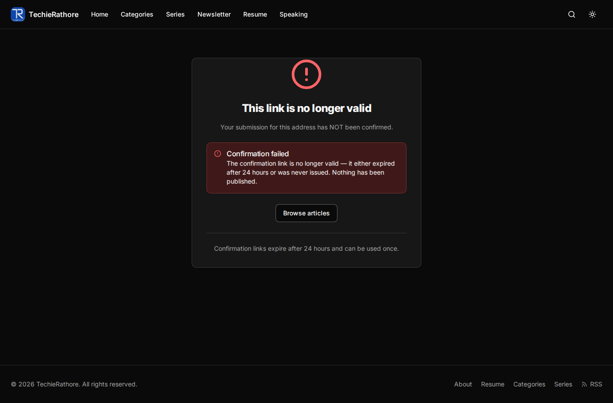

**Runtime:** renders the invalid-link state. Seen 2026-11-02, with a deliberately invalid token (a real one would confirm a subscription).

**Roles:** public

**Call chain:** `VerifyEmail.razor.cs:OnAfterRenderAsync` (first interactive render) → `CheckTokenAsync` → `EmailVerificationTokenRepo.GetByTokenAsync` (`EmailVerificationToken`); valid row: `IEmailVerificationService.ConsumeAsync` (`EmailVerificationSvc.cs:162`) → `ConsumeEmailVerificationToken(@pToken)` (`EmailVerificationTokenRepo.cs:60`) → promotes comment, rating or `Subscriber` target

| File and line | Function | Watch | Expected value |
|---|---|---|---|
| `source/BlogUI/Pages/BlogPages/VerifyEmail.razor.cs:236` | `CheckTokenAsync` | `row` | token row read without redeeming it |
| `source/BlogUI/Pages/BlogPages/VerifyEmail.razor.cs:247` | `CheckTokenAsync` | `row.IsUsed` | used tokens show "Already confirmed" and are never consumed |
| `source/BlogUI/Pages/BlogPages/VerifyEmail.razor.cs:254` | `CheckTokenAsync` | `row.ExpiresOn` | past 24 hours shows "no longer valid" with resend |
| `source/BlogUI/Pages/BlogPages/VerifyEmail.razor.cs:285` | `ConsumeTokenAsync` | `result` | success yields `Confirmed` or `SubscriptionConfirmed` |

**Calculations on this screen:** expiry check `ExpiresOn <= UtcNow`; `ConfirmationSummary` wording by purpose.

### Unsubscribe (`/unsubscribe/{token}`)

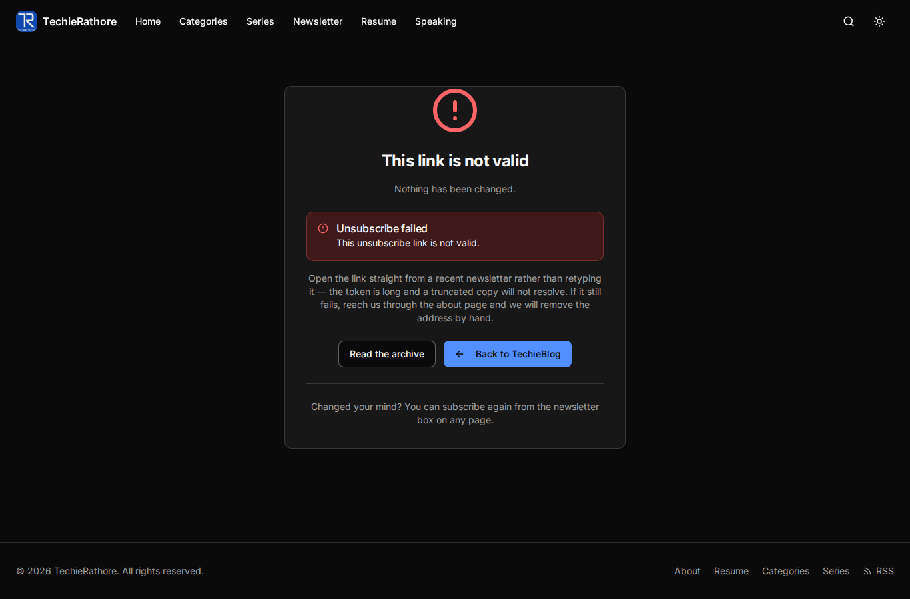

**Runtime:** renders the invalid-link state. Seen 2026-11-02, with a deliberately invalid token.

**Roles:** public, anonymous by design (`Unsubscribe.razor:9`). The route carries a token, so bare `/unsubscribe` is not routed.

**Call chain:** `Unsubscribe.razor.cs:OnAfterRenderAsync` → `ApplyTokenAsync` → `SubscriberSvc.UnsubscribeByTokenAsync` (`SubscriberSvc.cs:478`) → `SubscriberRepo` → `UnsubscribeToken` (read at line 189; `UPDATE UnsubscribeToken SET UsedOn` line 209) and `UPDATE Subscriber` (line 213)

| File and line | Function | Watch | Expected value |
|---|---|---|---|
| `source/BlogUI/Pages/BlogPages/Unsubscribe.razor.cs:178` | `ApplyTokenAsync` | `result` | failure shows the service's vague message |
| `source/BlogUI/Pages/BlogPages/Unsubscribe.razor.cs:188` | `ApplyTokenAsync` | `State` | `AlreadyUnsubscribed` if the outcome says so, else `Unsubscribed` |
| `source/BlogEngine/DbAccess/SubscriberRepo.cs:209` | consume SQL | `UsedOn` | set on first use; a replay changes nothing |

**Calculations on this screen:** none

### RSS feed page (`/rss`)

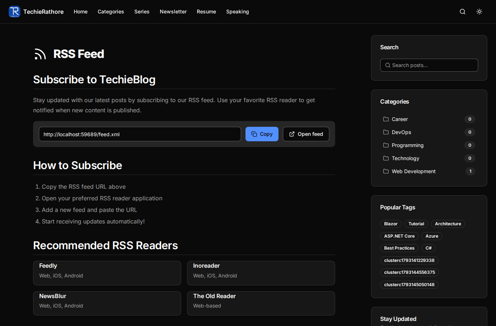

**Runtime:** renders. Seen 2026-11-02, anonymous.

**Roles:** public

**Call chain:** `RssFeed.razor:OnInitializedAsync` → `BlogSvc.GetPublishedPostsAsync(5, 0)` → `BlogPostRepo.GetPublishedPostsAsync` → `SelectPublishedSql`; the machine feed is a separate endpoint: `source/TechieBlog/Program.cs:775` (`RssFeedSvc.FeedPath = "/feed.xml"`, `RssFeedSvc.cs:91`) and `Program.cs:776` (`/rss.xml`), both to `RssFeedSvc.GenerateFeedAsync`. `/rss` itself is HTML.

| File and line | Function | Watch | Expected value |
|---|---|---|---|
| `source/BlogUI/Pages/BlogPages/RssFeed.razor:148` | `OnInitializedAsync` | `rssUrl` | `{BaseUri}feed.xml` |
| `source/BlogUI/Pages/BlogPages/RssFeed.razor:156` | `LoadRecentPostsAsync` | `recentPosts` | 5 newest published posts |
| `source/TechieBlog/Program.cs:747` | `/sitemap.xml` endpoint | response | `SitemapSvc.GenerateSitemapAsync`, `application/xml` |
| `source/TechieBlog/Program.cs:779` | `/robots.txt` endpoint | response | `Allow: /` and `Sitemap: {SiteSettings:BaseUrl}/sitemap.xml` (lines 780-786) |

**Calculations on this screen:** dates use `PublishedOn ?? CreatedOn` (`RssFeed.razor:113`).

### Sign in (`/login`, aliases `/LoginPage`, `/LoginPage/{PageCode}`)

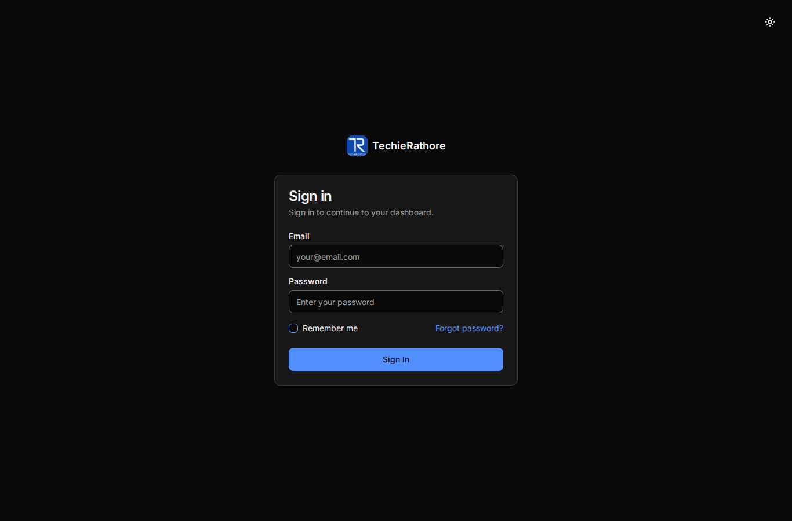

**Runtime:** renders. Seen 2026-11-02. All four test users signed in; landings: Admin and Editor `/admin`, Author `/BlogsList`, Contributor `/`.

**Roles:** public (no `[Authorize]`); a signed-in visitor is redirected away in `OnInitializedAsync` (`source/BlogUI/Pages/AdminPages/LoginPage.razor.cs:73-82`)

**Call chain:** `LoginPage.razor.cs:ValidateUser` → `TechieBlog/Services/AuthService.cs:LoginAsync` (host `IAuthService`) → `AuthSvc.AppLoginAsync` → `UserCredentialRepo.GetByEmailAsync` → `GetUserCredentialByEmail()` on `BlogUser` (`source/BlogEngine/DbAccess/UserCredentialRepo.cs:34,71`) → on success `loginlog` (`LoginLogRepo.cs:86`) and `userlogins` (`UserLoginRepo.cs:52`)

| File and line | Function | Watch | Expected value |
|---|---|---|---|
| `source/BlogUI/Pages/AdminPages/LoginPage.razor.cs:136` | `ValidateUser` | `validatedUser` | AppUser on valid credentials; null sets "Invalid email or password." (`:156`) |
| `source/TechieBlog/Services/AuthService.cs:91` | `LoginAsync` | `user.LoginPass` | encrypted before `AppLoginAsync` (`:95`); plaintext stays in the host adapter |
| `source/BlogEngine/Services/AuthSvc.cs:161` | `AppLoginAsync` | `loginThrottle.IsBlocked` | locked account returns null and writes one LoginLog row (`:166`) |
| `source/BlogModel/Common/PasswordHasher.cs:163` | `Verify` | `outcome` | `Failed` refuses (`AuthSvc.cs:280`); `SuccessNeedsRehash` upgrades the hash (`:284`) |
| `source/BlogEngine/Services/AuthSvc.cs:302` | `AuthenticateAsync` | `user.MustChangePassword` | copied from the credential row; `LoginPage.razor.cs:190` then routes to `/change-password` |

**Calculations on this screen:** PBKDF2-HMAC-SHA256 with 210,000 iterations (`PasswordHasher.cs:61`); access token exp 60 min and refresh window 14 days (`SessionPolicy.cs:54,73`).

### Forgot password (`/forgot-password`)

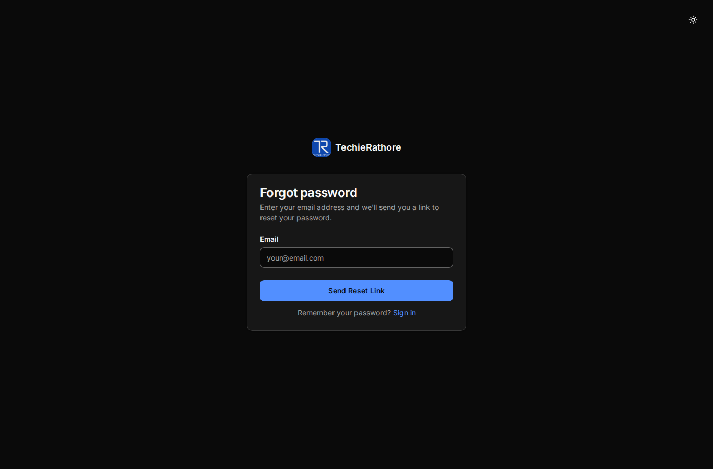

**Runtime:** renders. Seen 2026-11-02, anonymous.

**Roles:** public (no `[Authorize]`)

**Call chain:** `ForgotPasswordPage.razor:HandleSubmit` → `AuthSvc.RequestPasswordResetAsync` (`source/BlogEngine/Services/AuthSvc.cs:847`) → `BlogUserRepo.GetUserByEmailAsync` (`source/BlogEngine/DbAccess/BlogUserRepo.cs:299`, `GetUserByEmail()`) → `PasswordResetTokenRepo.InsertAsync` (`PasswordResetTokenRepo.cs:148`, `InsertPasswordResetToken()`) → `PasswordResetToken`; mail via `IEmailService`

| File and line | Function | Watch | Expected value |
|---|---|---|---|
| `source/BlogUI/Pages/AdminPages/ForgotPasswordPage.razor:91` | `HandleSubmit` | `message` | same text whether or not the address exists (`:107`) |
| `source/BlogEngine/Services/AuthSvc.cs:859` | `RequestPasswordResetAsync` | `result` | unknown address returns success with an empty token (`:864`) |
| `source/BlogEngine/Services/AuthSvc.cs:897` | `PersistResetTokenAsync` | `ExpiresAt` | UTC now + 24 h (`:905`) |
| `source/BlogEngine/Services/AuthSvc.cs:869` | `RequestPasswordResetAsync` | `BuildResetUrl(...)` | `{baseUrl}/reset-password/{token}` |

**Calculations on this screen:** token is 32 random bytes, base64url without padding (`AuthSvc.cs:1008-1014`).

### Reset password (`/reset-password`, `/reset-password/{Token}`)

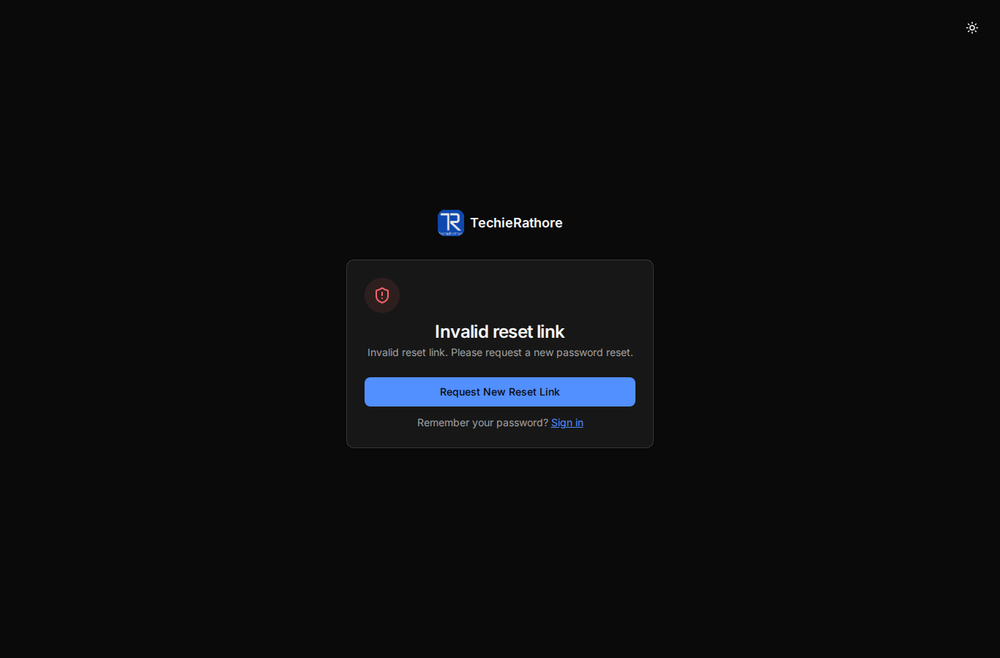

**Runtime:** renders the invalid-link state. Seen 2026-11-02, with a deliberately invalid token.

**Roles:** public (no `[Authorize]`); the token is the credential

**Call chain:** `ResetPasswordPage.razor:OnInitializedAsync` → `AuthSvc.ValidateResetTokenAsync` (`source/BlogEngine/Services/AuthSvc.cs:985`) → `PasswordResetTokenRepo.GetByTokenAsync` (`PasswordResetTokenRepo.cs:86`) → `PasswordResetToken`; submit: `ResetPasswordPage.razor:HandleSubmit` → `AuthSvc.ResetPasswordAsync` (`AuthSvc.cs:939`) → `UserCredentialRepo.UpdatePasswordHashAsync` (`UserCredentialRepo.cs:121`, `UpdateUserPassword()`) → `PasswordResetTokenRepo.MarkUsedAsync` (`PasswordResetTokenRepo.cs:111`, `MarkPasswordResetTokenUsed()`)

| File and line | Function | Watch | Expected value |
|---|---|---|---|
| `source/BlogUI/Pages/AdminPages/ResetPasswordPage.razor:136` | `OnInitializedAsync` | `tokenInvalid` | true for an empty token or a failed `ValidateResetTokenAsync` (unknown, expired, used) |
| `source/BlogUI/Pages/AdminPages/ResetPasswordPage.razor:165` | `HandleSubmit` | `model.Password` vs `ConfirmPassword` | mismatch shows "Passwords do not match." and stops |
| `source/BlogEngine/Services/AuthSvc.cs:950` | `ResetPasswordAsync` | `PasswordValidator.Validate` | rejects weak passwords before any write |
| `source/BlogEngine/Services/AuthSvc.cs:958` | `ResetPasswordAsync` | `mustChangePassword` argument | `false`: the user has chosen a password |
| `source/BlogUI/Pages/AdminPages/ResetPasswordPage.razor:190` | `HandleSubmit` | navigation URL | `/login?message=password-reset` (nothing on `/login` reads it; see Defects) |

**Calculations on this screen:** password policy from `PasswordValidator` (min 8, upper, lower, digit); a token is single use (`MarkUsedAsync`).

### Change password (`/change-password`)

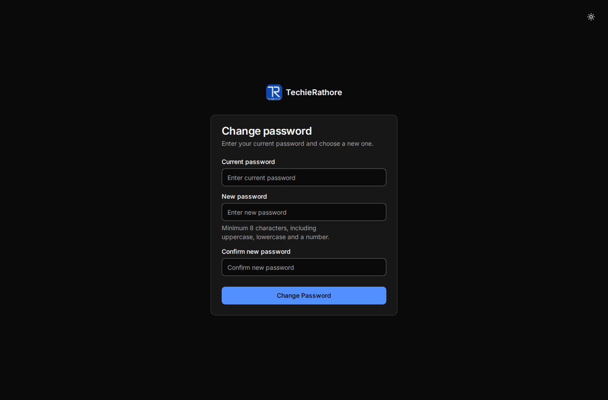

**Runtime:** renders. Seen 2026-11-02, as user 3 (Author); reached directly because the account is not flagged MustChangePassword on this database.

**Roles:** any signed-in role (`@attribute [Authorize]`, `source/BlogUI/Pages/AdminPages/ChangePasswordPage.razor:22`)

**Forced-change wall:** `source/BlogUI/Components/ForcePasswordChangeGuard.razor:89` `EnforceAsync` sends a flagged user to `/change-password` (navigate at `:114`). It is mounted once in `source/BlogUI/Routes.razor:17` and re-checks on `OnAfterRenderAsync` (`:36`), `OnLocationChanged` (`:54`) and `OnAuthenticationStateChanged` (`:67`). Login-time gate: `LoginPage.razor.cs:190`.

**Call chain:** `ChangePasswordPage.razor:HandleSubmit` → `AuthSvc.ChangePasswordAsync` (`source/BlogEngine/Services/AuthSvc.cs:1137`) → `UserCredentialRepo.GetByUserIdAsync` (`UserCredentialRepo.cs:96`, `GetUserCredentialById()`) → `UpdatePasswordHashAsync` (`UserCredentialRepo.cs:121`) → `BlogUser` (`UpdateUserPassword()`); then `CustomAuthStateProvider.RefreshAuthenticationStateAsync` (`source/BlogUI/Common/CustomAuthStateProvider.cs:347`)

| File and line | Function | Watch | Expected value |
|---|---|---|---|
| `source/BlogUI/Pages/AdminPages/ChangePasswordPage.razor:131` | `OnInitializedAsync` | `isForced` | true when the `MustChangePassword` claim equals "true" (`:136-139`) |
| `source/BlogEngine/Services/AuthSvc.cs:1152` | `ChangePasswordAsync` | `PasswordHasher.Verify(currentPassword)` | `Failed` returns "Current password is incorrect" |
| `source/BlogEngine/Services/AuthSvc.cs:1155` | `ChangePasswordAsync` | `PasswordValidator.Validate` | strength rule; the only place it is enforced for this screen |
| `source/BlogUI/Pages/AdminPages/ChangePasswordPage.razor:198` | `HandleSubmit` | `RefreshAuthenticationStateAsync` | rebuilds the principal so the cleared flag reaches the guard |
| `source/BlogUI/Pages/AdminPages/ChangePasswordPage.razor:202` | `HandleSubmit` | `NavigateTo` | `RoleLandingRoutes.ResolveFor(signedInRole)` after 1.2 s |

**Calculations on this screen:** none beyond the confirmation match (`ChangePasswordPage.razor:167`).

### Access denied (`/access-denied`)

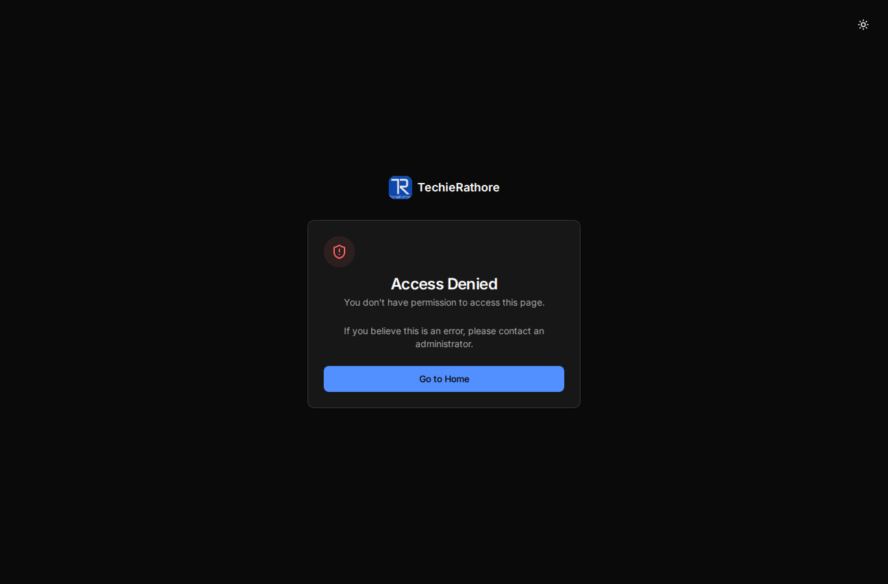

**Runtime:** renders. Seen 2026-11-02: user 4 (Contributor) asking for `/admin` lands on `/access-denied`.

**Roles:** public route (no `[Authorize]`). Reached by the `NotAuthorized` fragment in `source/BlogUI/Routes.razor:51-60`, then moved to the real route by `OnAfterRender`.

**Call chain:** `AccessDenied.razor:OnInitializedAsync` → `RoleLandingRoutes.ResolveFor(role claim)` (`source/BlogModel/Common/RoleLandingRoutes.cs`) → `AccessDenied.razor:OnAfterRender` → `NavigationManager.NavigateTo("/access-denied")`; no data access

| File and line | Function | Watch | Expected value |
|---|---|---|---|
| `source/BlogUI/Pages/AccessDenied.razor:99` | `OnInitializedAsync` | `LandingRoute` | the role's landing route, `/` when the role has none |
| `source/BlogUI/Pages/AccessDenied.razor:93` | `HasStaffLanding` | bool | true shows "Go to Dashboard" |
| `source/BlogUI/Pages/AccessDenied.razor:130` | `OnAfterRender` | `RendererInfo.IsInteractive` | navigates only on the first interactive render, from the NotAuthorized fragment |
| `source/BlogUI/Pages/AccessDenied.razor:147` | `IsOnOwnRoute` | path | path-only compare, so no redirect loop |

**Calculations on this screen:** none.

### Post editor (`/ManagePost`, aliases `/ManagePost/{PageId}`)

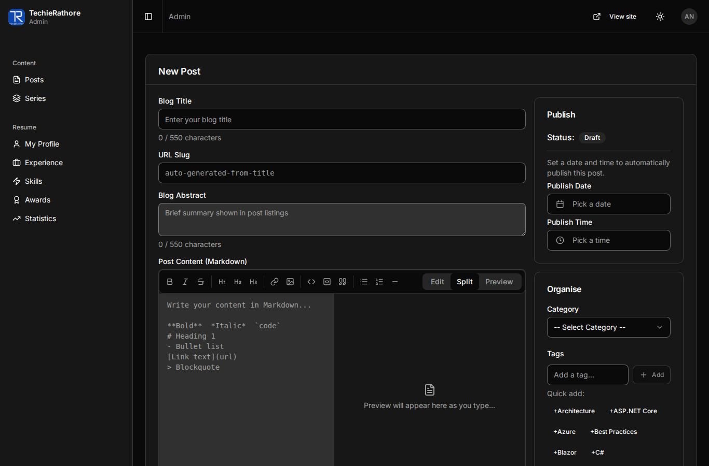

**Runtime:** renders. Seen 2026-11-02, as user 3 (Author), new post. Also seen: the author opened `/ManagePost/521`, a post owned by user 1, as a fully editable "Edit Post" form (Known issues, D3).

**Roles:** `AuthorOrAbove` (`source/BlogUI/Pages/AdminPages/ManagePost.razor:14`). The page does not check ownership of the loaded post (see Defects).

**Call chain:** `ManagePost.razor.cs:OnParametersSetAsync` → `LoadExistingPostAsync` → `BlogSvc.GetSinglePostAsync` (`source/BlogEngine/Services/BlogSvc.cs:213`) → `BlogPostRepo.GetSingleAsync` (`SelectByIdSql`, `BlogPost`); save: `ManagePost.razor.cs:SaveWithPublishState` → `BlogSvc.PublishPostAsync` or `SaveDraftAsync` → `SavePostAsync` (`BlogSvc.cs:632`) → `UpdatePostAsync` (`:571`) or `CreatePostAsync` → `BlogPostRepo` (`BlogPost` UPDATE at `BlogPostRepo.cs:218-232`, INSERT at `:210`); tags: `TagSvc.SetTagsForPostAsync` (`TagSvc.cs:559`) → `BlogTagRepo.SetTagsForPostAsync` (`BlogTagRepo.cs:436`, `DELETE`/`INSERT` on `PostTag`)

| File and line | Function | Watch | Expected value |
|---|---|---|---|
| `source/BlogUI/Pages/AdminPages/ManagePost.razor.cs:257` | `OnParametersSetAsync` | `PageObj` | the routed post; `PageId <= 0` gives a new BlogPost with `Published = false` (`:279-282`) |
| `source/BlogUI/Pages/AdminPages/ManagePost.razor.cs:633` | `SaveWithPublishState` | `result.IsSuccess` | post saved, tags re-synced; publish navigates to `/BlogsList` after 500 ms (`:726-727`) |
| `source/BlogEngine/Services/BlogSvc.cs:694` | `SaveDraftAsync` | `post.ScheduledPublishOn` | expected cleared on a draft save; it is not cleared (see Defects) |
| `source/BlogEngine/Services/BlogSvc.cs:599` | `UpdatePostAsync` | `post.Slug` | `EnsureSlug` then `ResolveUniqueSlugAsync` (`:599-602`) |
| `source/BlogUI/Pages/AdminPages/ManagePost.razor.cs:518` | `AddNewTagAsync` | `tag` | `TagSvc.GetOrCreateTagAsync` (`TagSvc.cs:308`) returns an existing or new tag |

**Calculations on this screen:** `TitleCharCountLabel` and `AbstractCharCountLabel` (`ManagePost.razor.cs:87-124`, limits from `BlogPost.TitleMaxLength` / `AbstractMaxLength`); slug from `SlugGenerator.GenerateSlug` (`source/BlogEngine/Common/SlugGenerator.cs:76`) at `ManagePost.razor.cs:425,477,677,834`; scheduled time is local, converted to UTC at `:838`.

### Posts list (`/BlogsList`)

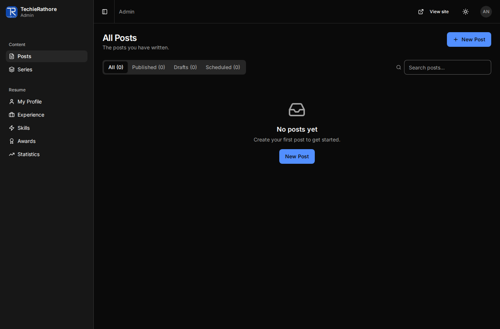

**Runtime:** renders empty. Seen 2026-11-02, as user 3 (Author): the author owns no live post on this database. As user 1 (Admin) it lists 3 posts, and typing in the search box crashes the page (Known issues, TR-077).

**Roles:** `AuthorOrAbove` (`source/BlogUI/Pages/AdminPages/BlogsList.razor:14`). Admin or Editor see every post; other roles see their own.

**Call chain:** `BlogsList.razor.cs:OnInitializedAsync` (`:112`) → `LoadPostsAsync` (`:133`) → `BlogSvc.GetAllPostsAsync` (`source/BlogEngine/Services/BlogSvc.cs:186`) → `BlogPostRepo.GetAllAsync` (`SelectAllSql`, `BlogPostRepo.cs:112`, `FROM BlogPost`) or `GetAllByIdAsync` (`SelectAllByUserSql`, `:127`, `WHERE p.UserID = @UserID`)

| File and line | Function | Watch | Expected value |
|---|---|---|---|
| `source/BlogUI/Pages/AdminPages/BlogsList.razor.cs:112` | `OnInitializedAsync` | `isAdminOrEditor` | true when the principal is in `Admin` or `Editor` |
| `source/BlogUI/Pages/AdminPages/BlogsList.razor.cs:135` | `LoadPostsAsync` | `posts` | every post for Admin or Editor; the caller's own posts otherwise |
| `source/BlogUI/Pages/AdminPages/BlogsList.razor.cs:154` | `ApplyFilter` | `filtered` | status tab: published, scheduled (`IsScheduled`), draft; then search over Title, Slug, BlogWriter |
| `source/BlogUI/Pages/AdminPages/BlogsList.razor.cs:217` | `NavigateToPreviewAsync` | `post.Published` | published posts open `/post/{slug}` externally; drafts go to `/admin/preview/{id}` |
| `source/BlogUI/Pages/AdminPages/BlogsList.razor.cs:320` | `CancelScheduleAsync` | `BlogService.CancelScheduleAsync` | `BlogSvc.cs:929` clears the schedule and keeps the post a draft |

**Calculations on this screen:** status and search filters in `ApplyFilter`; the tab counts are derived from the same list.

### Draft preview (`/admin/preview/{PostId}`)

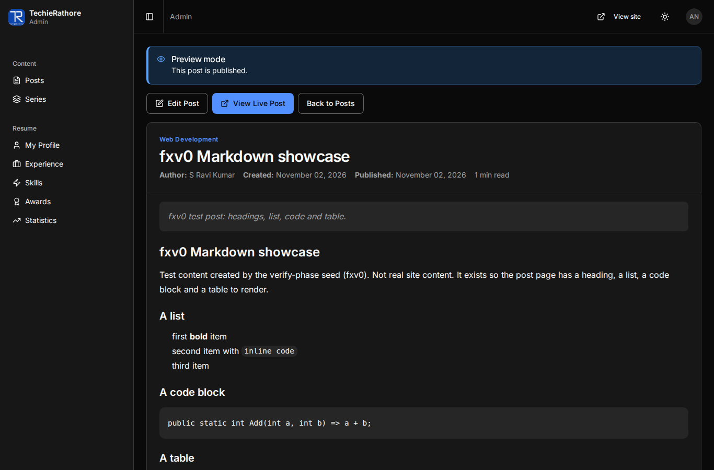

**Runtime:** renders. Seen 2026-11-02, as user 3 (Author), `/admin/preview/521`, a post owned by user 1.

**Roles:** `AuthorOrAbove` (`source/BlogUI/Pages/AdminPages/PreviewPost.razor:11`). No ownership check on the post.

**Call chain:** `PreviewPost.razor:OnInitializedAsync` (`:212`) → `LoadPost` (`:218`) → `BlogSvc.GetSinglePostAsync` (`BlogSvc.cs:213`) → `BlogPostRepo.GetSingleAsync` (`BlogPost`); tags: `TagSvc.GetTagsForPostAsync` (`TagSvc.cs:524`) → `PostTag`; publish: `HandlePublish` (`:243`) → `BlogSvc.QuickPublishAsync` (`BlogSvc.cs:798`) → `BlogPostRepo.UpdateAsync`

| File and line | Function | Watch | Expected value |
|---|---|---|---|
| `source/BlogUI/Pages/AdminPages/PreviewPost.razor:223` | `LoadPost` | `blogPost` | the post; a thrown exception sets null (`:235-238`) |
| `source/BlogUI/Pages/AdminPages/PreviewPost.razor:228` | `LoadPost` | `postTags` | tag names from the `PostTag` junction, not the legacy Tags text |
| `source/BlogUI/Pages/AdminPages/PreviewPost.razor:252` | `HandlePublish` | `result.IsSuccess` | `QuickPublishAsync` sets Published and clears the schedule (`BlogSvc.cs:816`) |
| `source/BlogUI/Pages/AdminPages/PreviewPost.razor:259` | `HandlePublish` | `Navigation.NavigateTo` | `/post/{slug}` after a 1 s delay (`:258`) |
| `source/BlogUI/Pages/AdminPages/PreviewPost.razor:307` | `RenderContent` | html | `MarkdownRenderer.ToHtml`; empty body shows "No content available." |

**Calculations on this screen:** `GetReadingTime` via `ReadingTimeCalculator.Calculate` (`PreviewPost.razor:301-304`).

### Series admin (`/admin/series`, aliases `/SeriesList`; editor at `/admin/series/new` and `/admin/series/{PageId}`)

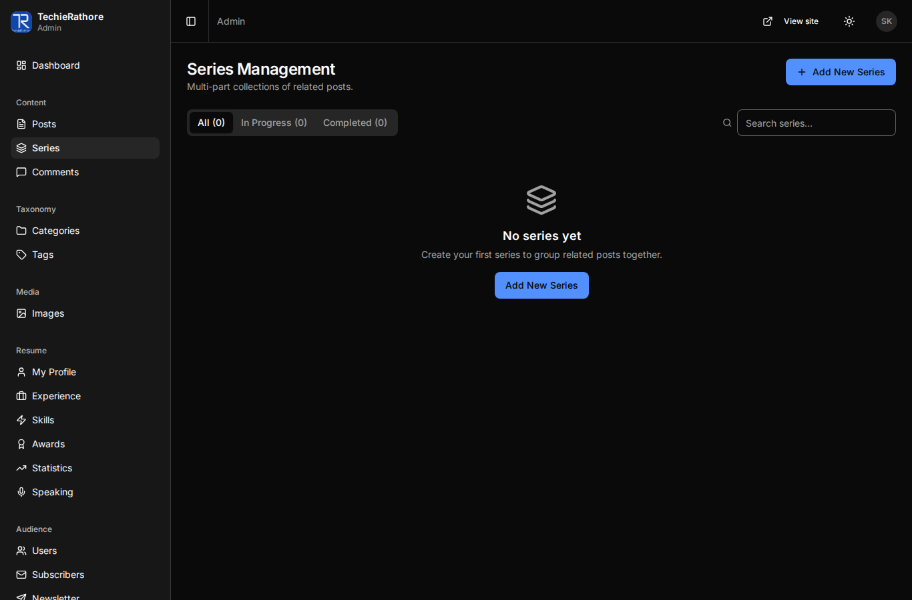

**Runtime:** renders empty. Seen 2026-11-02, as user 1 (Admin): 0 series on this database.

**Roles:** `AuthorOrAbove` on both `source/BlogUI/Pages/AdminPages/SeriesList.razor:12` and `ManageSeries.razor:12`. No owner scoping (see Defects).

**Call chain:** `SeriesList.razor:OnInitializedAsync` (`:238`) → `LoadSeriesAsync` (`:254`) → `SeriesSvc.GetAllWithCountsAsync` (`source/BlogEngine/Services/SeriesSvc.cs:161`) → `BlogSeriesRepo.GetAllWithCountsAsync` (`BlogSeriesRepo.cs:174`, `FROM BlogSeries s`); delete: `SeriesList.razor:DeleteSeriesAsync` (`:324`) → `SeriesSvc.DeleteSeriesAsync` (`:575`) → `BlogPostRepo.ClearSeriesFromPostsAsync` → `BlogSeriesRepo.DeleteAsync`; editor: `ManageSeries.razor.cs:OnParametersSetAsync` (`:46`) → `SeriesSvc.GetSeriesAsync` (`SeriesSvc.cs:193`)

| File and line | Function | Watch | Expected value |
|---|---|---|---|
| `source/BlogUI/Pages/AdminPages/SeriesList.razor:258` | `LoadSeriesAsync` | `ObjectList` | every series with its post count (`PostCount` is a LEFT JOIN on published, non-deleted posts, `BlogSeriesRepo.cs:42`) |
| `source/BlogUI/Pages/AdminPages/SeriesList.razor:276` | `ApplyFilter` | `FilteredList` | status (`inprogress`, `complete`) then search over Name, Slug, AuthorName |
| `source/BlogUI/Pages/AdminPages/SeriesList.razor:324` | `DeleteSeriesAsync` | `result.IsSuccess` | series removed; its posts stay, with the series link cleared |
| `source/BlogUI/Pages/AdminPages/ManageSeries.razor.cs:46` | `OnParametersSetAsync` | `PageObj` | existing series for `PageId > 0`; `PageId == 0` gives a new series with `AuthorId` set to the caller (`:71-80`) |
| `source/BlogUI/Pages/AdminPages/ManageSeries.razor.cs:100` | `SaveDataAsync` | `result.IsSuccess` | `SaveSeriesAsync` (`:111`), then `ReorderPartsAsync` (`SeriesSvc.cs:342`) when editing a series with more than one part; success goes to `/admin/series` |

**Calculations on this screen:** `InProgressCount` and `CompleteCount` (`SeriesList.razor:227-228`); `Slug` via `SlugGenerator.EnsureSlug` (`SeriesSvc.cs:482-531`).

### Media library (`/admin/images`) and ImagePicker component

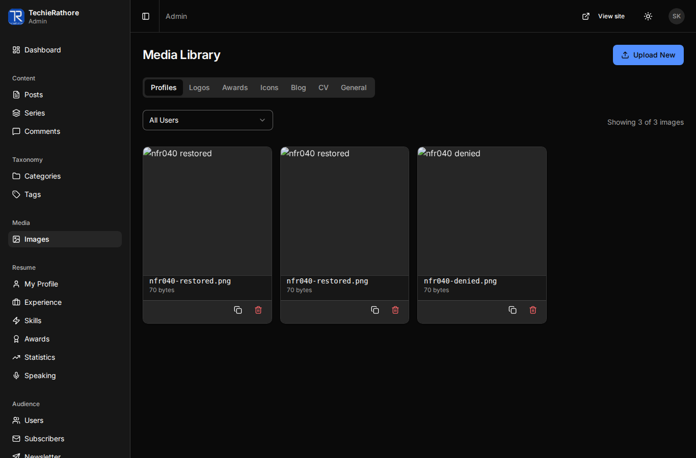

**Runtime:** renders. Seen 2026-11-02, as user 1 (Admin).

**Roles:** `AdminOnly` (`source/BlogUI/Pages/AdminPages/ManageImages.razor:11`). `ImagePicker` has no attribute and inherits its host page's policy.

**Call chain:** `ManageImages.razor.cs:UploadFile` (`:342`) → `BlogImageService.UploadImageAsync` (`source/BlogEngine/Services/BlogImageService.cs:162`) → `ValidateImageAsync` (`:144`) → `StoreAsync` (`:309`) → `WriteBytesAsync` (`:367`) → `IFileStorage.SaveAsync` (`source/BlogEngine/Storage/FileSystemStorage.cs:92`) → `PersistMetadata` (`:473`) → `BlogImageRepo.InsertToGetId` → `BlogImage`. Delete: `ConfirmDelete` (`ManageImages.razor.cs:499`) → `DeleteImageAsync` (`BlogImageService.cs:184`) → `RemoveStoredFileAsync` (`:561`) → `DELETE FROM BlogImage` (`:585`)

| File and line | Function | Watch | Expected value |
|---|---|---|---|
| `source/BlogUI/Pages/AdminPages/ManageImages.razor.cs:163` | `LoadImages` | `AllImages` | `GetImagesByCategoryAsync` (`BlogImageService.cs:213`), filtered by category and optional user |
| `source/BlogModel/Common/ImageCategoryRules.cs:193` | `For` (rule table) | `MaxSizeBytes` | profiles 2 MB, logos and awards 500 KB, icons 200 KB, blog and general 5 MB, cv 10 MB |
| `source/BlogEngine/Services/BlogImageService.cs:621` | `ValidateAgainstConstraints` | `file.Size` | over `MaxSizeBytes` is refused; the same value caps `OpenReadStream` (`:413`) |
| `source/BlogEngine/Services/BlogImageService.cs:176` | `UploadImageAsync` | `relativePath` | `uploads/{category}/{category}-{userId}-{yyyyMMddHHmmss}-{8 hex}.{ext}` (`:641-649`) under the storage root (`source/BlogEngine/Storage/UploadsLocation.cs:82,130`; host default `wwwroot`) |
| `source/BlogEngine/Services/BlogImageService.cs:196` | `DeleteImageAsync` | `image.UserID` | the owner id must equal the caller id; the page passes the owner id (`ManageImages.razor.cs:509`) |

**Calculations on this screen:** 12 per page, `TotalPages = ceil(TotalImages / PageSize)` (`ManageImages.razor.cs:95-96`). `ImagePicker`: `OpenGallery` (`ImagePicker.razor.cs:86`) lists the caller's own uploads (`GetImagesByCategoryAsync(Category, UserId)` at `:94`); `SelectImage` (`:142`) writes `PageObj.FeaturedImage` (`ManagePost.razor:330`).

### Admin dashboard (`/admin`, aliases `/AdminDashboard`)

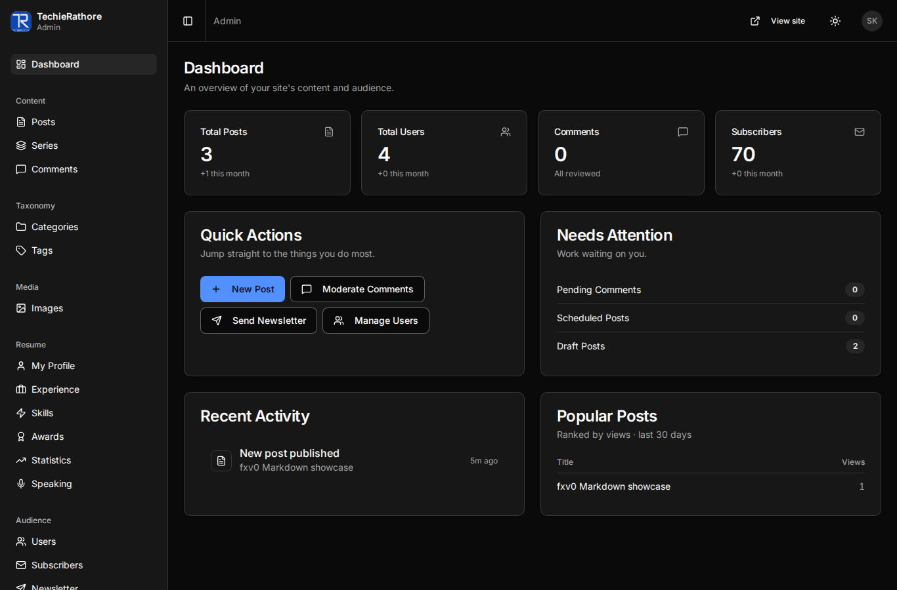

**Runtime:** renders. Seen 2026-11-02, as user 1 (Admin): live tiles (3 posts, 4 users, 0 comments, 70 subscribers).

**Roles:** `EditorOrAbove` (`source/BlogUI/Pages/AdminPages/AdminDashboard.razor:13`); the "Pending comments" and admin-only tiles sit inside `AuthorizeView Policy="AdminOnly"` (`AdminDashboard.razor:107`).

**Call chain:** `AdminDashboard.razor.cs:OnInitializedAsync` → `DashboardSvc.GetAdminCountsAsync` (`source/BlogEngine/Services/DashboardSvc.cs:52`) → `AdminCountsRepo.GetAdminCountsAsync` (`source/BlogEngine/DbAccess/AdminCountsRepo.cs:119`) → one scalar SELECT over `BlogPost`, `BlogComment`, `BlogUser`, `Subscriber`, `Newsletter`, `PostViews`, `Tag`, `Category`, `BlogImage` (`SelectCountsSql`, lines 72-88)

| File and line | Function | Watch | Expected value |
|---|---|---|---|
| `source/BlogUI/Pages/AdminPages/AdminDashboard.razor.cs:117` | `OnInitializedAsync` | `counts` | aggregate tiles populated in one read |
| `source/BlogUI/Pages/AdminPages/AdminDashboard.razor.cs:152-161` | `ApplyCounts` | `PendingComments` | `= counts.UnAppComments` (see Defects) |
| `source/BlogEngine/DbAccess/AdminCountsRepo.cs:77` | `SelectCountsSql` | `UnAppComments` | `COUNT(*) WHERE Published = FALSE` |
| `source/BlogUI/Pages/AdminPages/AdminDashboard.razor.cs:176-187` | `LoadPostBreakdownAsync` | `DraftPosts`, `ScheduledPosts`, `PostsThisMonth` | drafts = `!Published && !IsScheduled`; scheduled = `IsScheduled`; created since UTC month start |
| `source/BlogEngine/Services/AnalyticsSvc.cs:53` | `GetPopularPostsAsync` | `PopularPosts` | top posts by view count in the popular window (`AnalyticsRepo.cs:187`) |

**Calculations on this screen:** `LoadPostBreakdownAsync` partitions the post list into draft, scheduled and this-month counts. `ApplyCounts` is a straight copy. No other arithmetic.

### User management (`/users`)

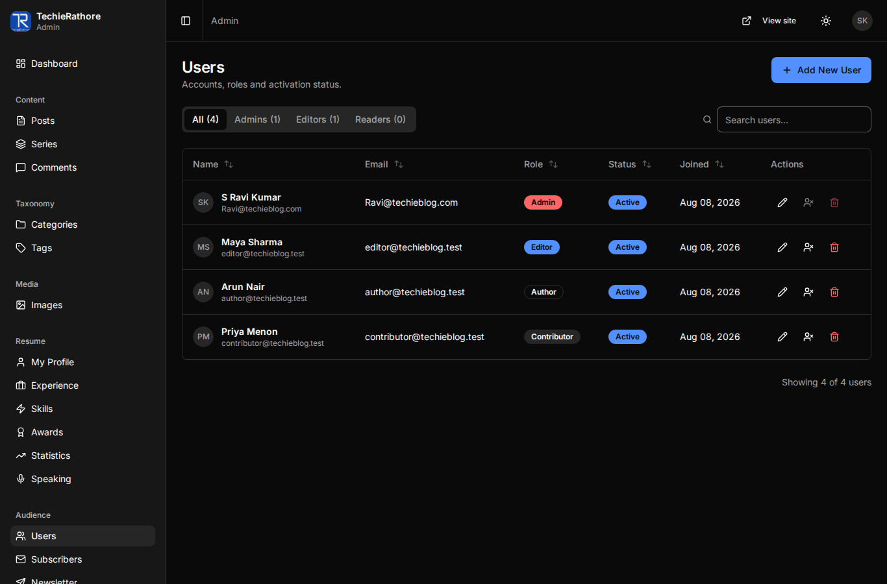

**Runtime:** renders. Seen 2026-11-02, as user 1 (Admin).

**Roles:** `AdminOnly` (`source/BlogUI/Pages/AdminPages/UsersList.razor:11`).

**Call chain:** `UsersList.razor.cs:LoadUsers` → `BlogUserRepo.GetAllAsync` (`source/BlogEngine/DbAccess/BlogUserRepo.cs:151`) → `BlogUser` (`SelectAllSql`, line 62; `NotDeleted` filter, line 818). Delete: `ConfirmDelete` → `BlogUserRepo.SoftDeleteUserAsync` (line 549) → `SoftDeleteBlogUser()` (`source/BlogDb/PostgresScripts/030-UserAdminEditDelete.sql:174`) → `BlogUser`.

| File and line | Function | Watch | Expected value |
|---|---|---|---|
| `source/BlogUI/Pages/AdminPages/UsersList.razor.cs:167-171` | `LoadUsers` | `ObjectList` | every non-deleted account, ordered by `UserId` |
| `source/BlogUI/Pages/AdminPages/UsersList.razor.cs:390-413` | `SaveUserChanges` | `UserToEdit` | `BlogUserRepo.UpdateAsync` writes name, email and role |
| `source/BlogUI/Pages/AdminPages/UsersList.razor.cs:524` | `ConfirmDelete` | `deleted` | soft delete: `IsDeleted = TRUE`, `IsConfirmed = FALSE`; row kept |
| `source/BlogUI/Pages/AdminPages/UsersList.razor.cs:577` | `ToggleUserStatus` | `updated` | `SetBlogUserActive` (`030-UserAdminEditDelete.sql:85`) flips `IsConfirmed` on live rows only |
| `source/BlogUI/Pages/AdminPages/UsersList.razor.cs:305-314` | `DeleteBlockReason` | `reason` | non-null for the site owner, so the delete is refused |

**Calculations on this screen:** role tab counts (`AdminCount`, `EditorCount`, `ReaderCount`) are in-page tallies of `ObjectList`. No other arithmetic.

### Add user (`/AddUser`)

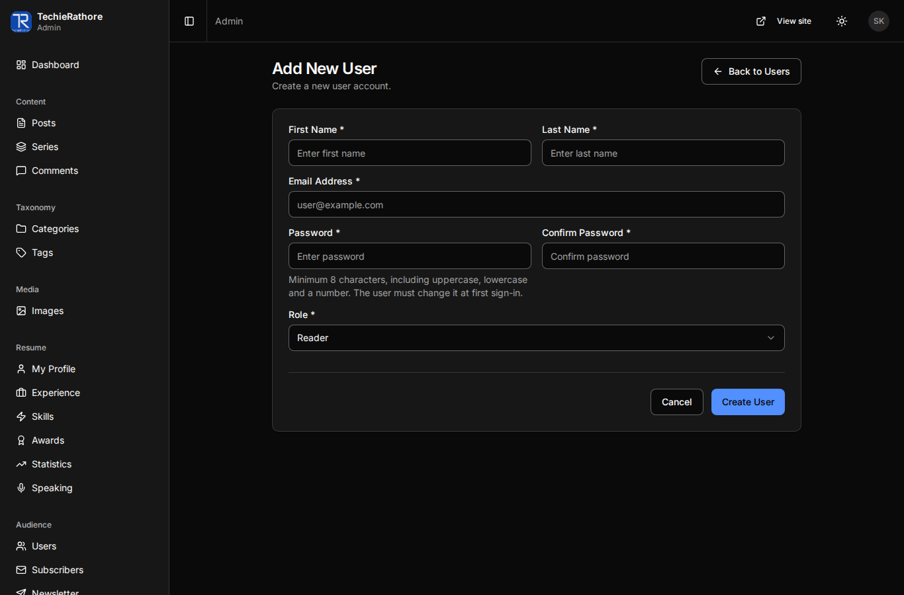

**Runtime:** renders. Seen 2026-11-02, as user 1 (Admin).

**Roles:** `AdminOnly` (`source/BlogUI/Pages/AdminPages/AddUser.razor:18`).

**Call chain:** `AddUser.razor:HandleSubmit` (line 197) → `AuthSvc.CreateStaffAccountAsync` (`source/BlogEngine/Services/AuthSvc.cs:735`) → `BlogUserRepo.InsertToGetIdAsync` (`InsertBlogUser`, `BlogUserRepo.cs:69`) → `UpdatePasswordHashAsync` (`AuthSvc.cs:755`) → `{unresolved — credential table name not read}`

| File and line | Function | Watch | Expected value |
|---|---|---|---|
| `source/BlogUI/Pages/AdminPages/AddUser.razor:199` | `HandleSubmit` | `Password` vs `ConfirmPassword` | mismatch rejected before the service call |
| `source/BlogEngine/Services/AuthSvc.cs:744-747` | `CreateStaffAccountAsync` | `validation` | required fields, `PasswordValidator`, email uniqueness |
| `source/BlogEngine/Services/AuthSvc.cs:750` | `CreateStaffAccountAsync` | `userId` | new `BlogUser` id; `<= 0` is a failure |
| `source/BlogEngine/Services/AuthSvc.cs:755` | `CreateStaffAccountAsync` | `MustChangePassword` flag | set `true` on the new credential |
| `source/BlogUI/Pages/AdminPages/AddUser.razor:174` | field init | `NewUser.UserRole` | default `"Reader"` |

**Calculations on this screen:** none. Password hashing is `PasswordHasher.HashPassword`, called from `AuthSvc`.

### Comment moderation (`/CommentsList`, alias `/comments`)

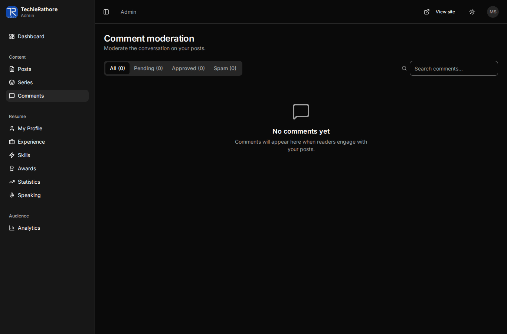

**Runtime:** renders empty. Seen 2026-11-02, as user 2 (Editor): 0 comments waiting.

**Roles:** `EditorOrAbove` (`source/BlogUI/Pages/AdminPages/CommentsList.razor:12`).

**Call chain:** `CommentsList.razor:LoadCommentsAsync` (line 371) → `CommentSvc.GetAllCommentsAsync` (`source/BlogEngine/Services/CommentSvc.cs:733`) → `BlogCommentRepo.GetAllAsync` (`source/BlogEngine/DbAccess/BlogCommentRepo.cs`, `SelectAllSql` line 42) → `blogcomment`

| File and line | Function | Watch | Expected value |
|---|---|---|---|
| `source/BlogUI/Pages/AdminPages/CommentsList.razor:378` | `LoadCommentsAsync` | `comments` | all comments, newest first |
| `source/BlogUI/Pages/AdminPages/CommentsList.razor:547` | `ApproveCommentAsync` | `result` | `CommentSvc.ApproveCommentAsync` (`CommentSvc.cs:763`) refuses unverified email, then `ApproveBlogCommentAsync` (`BlogCommentRepo.cs:508`) sets `Approved`, `published = TRUE` |
| `source/BlogUI/Pages/AdminPages/CommentsList.razor:484` | bulk apply | `selectedIds` | `ApproveCommentsAsync` → `SetModerationStatusBulkAsync` (`BlogCommentRepo.cs:564`) adds `AND isemailverified = TRUE` |
| `source/BlogUI/Pages/AdminPages/CommentsList.razor:568` | reject | `status` | `RejectCommentAsync` (`CommentSvc.cs:515`) → `Spam`, `published = FALSE` |
| `source/BlogUI/Pages/AdminPages/CommentsList.razor:616` | `DeleteCommentAsync` | row | `CommentSvc.DeleteCommentAsync` (`CommentSvc.cs:801`) → `DELETE FROM blogcomment` (`BlogCommentRepo.cs:669`) |

**Calculations on this screen:** `ApprovedCount` (line 312) counts `Status == "Approved"`. Status mapping (lines 364-366) maps the stored moderation status to a label.

### Category management (`/admin/categories`, alias `/CategoriesList`; edit `/admin/category`, `/admin/category/{PageId}`)

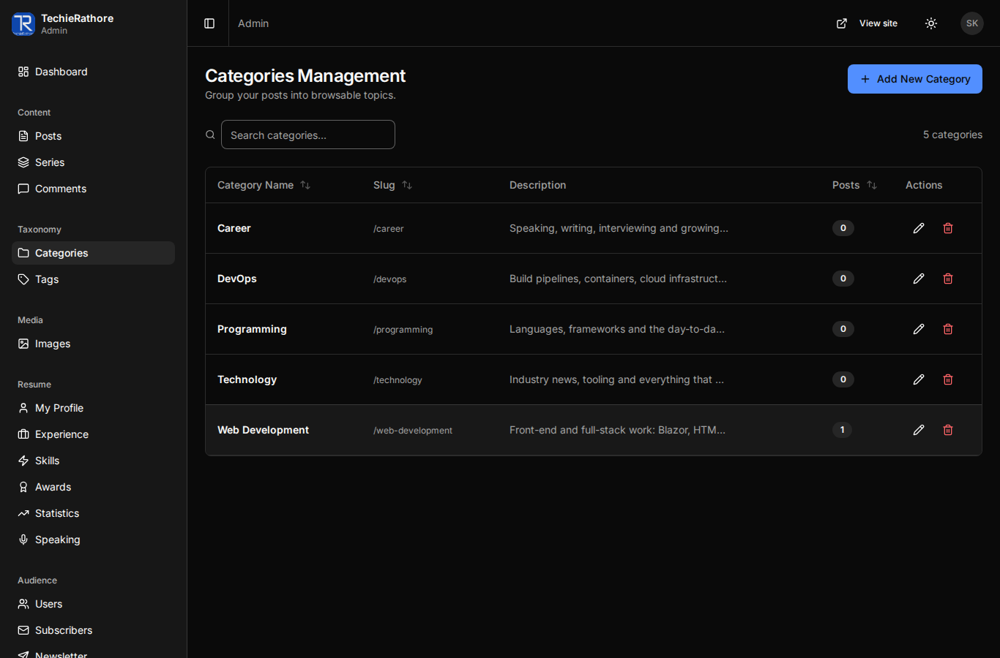

**Runtime:** renders. Seen 2026-11-02, as user 1 (Admin).

**Roles:** `AdminOnly` on both the list (`source/BlogUI/Pages/AdminPages/CategoriesList.razor:12`) and the edit page (`ManageCategory.razor:12`).

**Call chain:** `CategoriesList.razor:LoadCategoriesAsync` (line 220) → `CategorySvc.GetAllWithCountsAsync` (`source/BlogEngine/Services/CategorySvc.cs:146`, cached) → `CategoryRepo.GetAllWithCountsAsync` (`source/BlogEngine/DbAccess/CategoryRepo.cs:130`) → `Category` LEFT JOIN `BlogPost`. Delete: `DeleteCategory` (line 276) → `CategorySvc.DeleteCategoryAsync` (`CategorySvc.cs:345`) → `CategoryRepo.DeleteAsync` (line 320; `DELETE FROM Category`, line 90).

| File and line | Function | Watch | Expected value |
|---|---|---|---|
| `source/BlogUI/Pages/AdminPages/CategoriesList.razor:224` | `LoadCategoriesAsync` | `ObjectList` | categories with `PostCount` of published, non-deleted posts |
| `source/BlogEngine/DbAccess/CategoryRepo.cs:45-50` | `SelectAllWithCountsSql` | `PostCount` | `COUNT(p.PostID)` with `Published = TRUE` and not deleted |
| `source/BlogUI/Pages/AdminPages/CategoriesList.razor:280` | `DeleteCategory` | `result` | hard delete; list reloads |
| `source/BlogUI/Pages/AdminPages/ManageCategory.razor.cs:40` | `OnParametersSetAsync` | `PageObj` | `GetCategoryAsync` loads the row for edit |
| `source/BlogUI/Pages/AdminPages/ManageCategory.razor.cs:77` | `SaveDataAsync` | `result` | `CategorySvc.SaveCategoryAsync` (`CategorySvc.cs:323`) inserts or updates `Category` |

**Calculations on this screen:** `PostCount` (SQL, above). The delete dialog warns that `PostCount` posts become uncategorized, which matches `ON DELETE SET NULL` on `blogpost_categoryid_fkey` (`source/BlogDb/PostgresScripts/023-CategoryAssignmentAndImageMetadata.sql:23`).

### Tag management (`/admin/tags`, alias `/TagsList`; edit `/ManageTag`, `/ManageTag/{PageId}`)

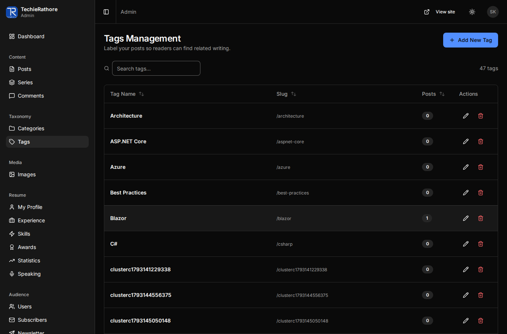

**Runtime:** renders. Seen 2026-11-02, as user 1 (Admin).

**Roles:** `AdminOnly` on both `TagsList.razor:12` and `ManageTag.razor:12`.

**Call chain:** `TagsList.razor:LoadTagsAsync` (line 198) → `TagSvc.GetAllWithCountsAsync` (`source/BlogEngine/Services/TagSvc.cs:165`, cached) → `BlogTagRepo.GetAllWithCountsAsync` (`source/BlogEngine/DbAccess/BlogTagRepo.cs:187`) → `Tag` with `PostTag` count. Delete: `TagsList.razor:253` → `TagSvc.DeleteTagAsync` (`TagSvc.cs:487`) → `BlogTagRepo.DeleteAsync` (`BlogTagRepo.cs:389`; `DELETE FROM Tag`, line 90) → `Tag`; `PostTag` rows cascade (`source/BlogDb/PostgresScripts/007-FixBlogSeriesAndPostTag.sql:75`).

| File and line | Function | Watch | Expected value |
|---|---|---|---|
| `source/BlogUI/Pages/AdminPages/TagsList.razor:202` | `LoadTagsAsync` | `TagList` | tags with `PostCount` |
| `source/BlogEngine/DbAccess/BlogTagRepo.cs:39` | `SelectAllWithCountsSql` | `PostCount` | `COUNT(p.PostId)` per tag |
| `source/BlogEngine/Services/TagSvc.cs:487-505` | `DeleteTagAsync` | `existing` | existence check, hard delete, taxonomy cache invalidated |
| `source/BlogUI/Pages/AdminPages/ManageTag.razor:134` | `LoadTagAsync` | `pageObj` | `TagSvc.GetSingleTagAsync` |
| `source/BlogUI/Pages/AdminPages/ManageTag.razor:170` | `SaveDataAsync` | `result` | `TagSvc.SaveTagAsync` (`TagSvc.cs:458`) |

**Calculations on this screen:** `PostCount` only, computed in SQL.

### Subscribers (`/admin/subscribers`)

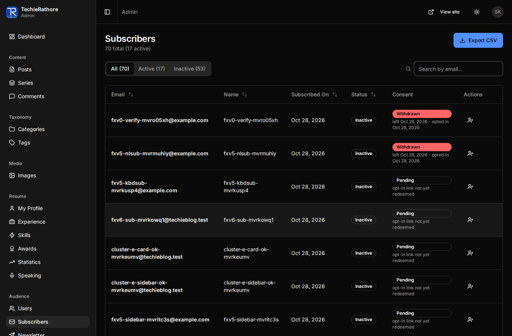

**Runtime:** renders. Seen 2026-11-02, as user 1 (Admin): 70 subscribers listed.

**Roles:** `AdminOnly` (`source/BlogUI/Pages/AdminPages/SubscribersList.razor:11`).

**Call chain:** `SubscribersList.razor:LoadSubscribersAsync` (line 259) → `SubscriberSvc.GetAllSubscribersAsync` (`source/BlogEngine/Services/SubscriberSvc.cs:789`) → `SubscriberRepo.GetAllAsync` (`source/BlogEngine/DbAccess/SubscriberRepo.cs:264`) → `Subscriber`. Deactivate: `ToggleStatusAsync` (line 316) → `SubscriberSvc.UpdateSubscriberStatusAsync` (`SubscriberSvc.cs:892`) → `SubscriberRepo.UpdateStatusAsync` (`SubscriberRepo.cs:556`) → `UPDATE Subscriber SET IsConfirmed = @IsActive` (line 236).

BRD-57 check: the admin path issues an UPDATE, never a DELETE. `SubscriberRepo.cs` has no `DELETE` statement, and no `DELETE FROM Subscriber` exists under `source/BlogEngine` or `source/BlogDb`. [Certain]

| File and line | Function | Watch | Expected value |
|---|---|---|---|
| `source/BlogUI/Pages/AdminPages/SubscribersList.razor:316-331` | `ToggleStatusAsync` | `IsActive` | flips the row; the row stays in the grid |
| `source/BlogEngine/Services/SubscriberSvc.cs:892-907` | `UpdateSubscriberStatusAsync` | `subscriber` | existence check, then `UpdateStatusAsync`; no delete |
| `source/BlogEngine/DbAccess/SubscriberRepo.cs:235-237` | `UpdateStatusSql` | `IsConfirmed` | the only write on this screen |
| `source/BlogUI/Pages/AdminPages/SubscribersList.razor:333-347` | `ExportToCsv` | `csv` | exports `FilteredList` (current tab plus search) as `Email,Name,SubscribedOn,Status` via `SubscriberCsv.Build` (`source/BlogEngine/Common/SubscriberCsv.cs:44`) |

**Calculations on this screen:** `IsActive` is `COALESCE(IsConfirmed, TRUE)` (`SubscriberRepo.cs:59`). `SubscriberCsv.Quote` (line 62) prefixes `=+-@` with `'`.

### Site settings (`/settings`)

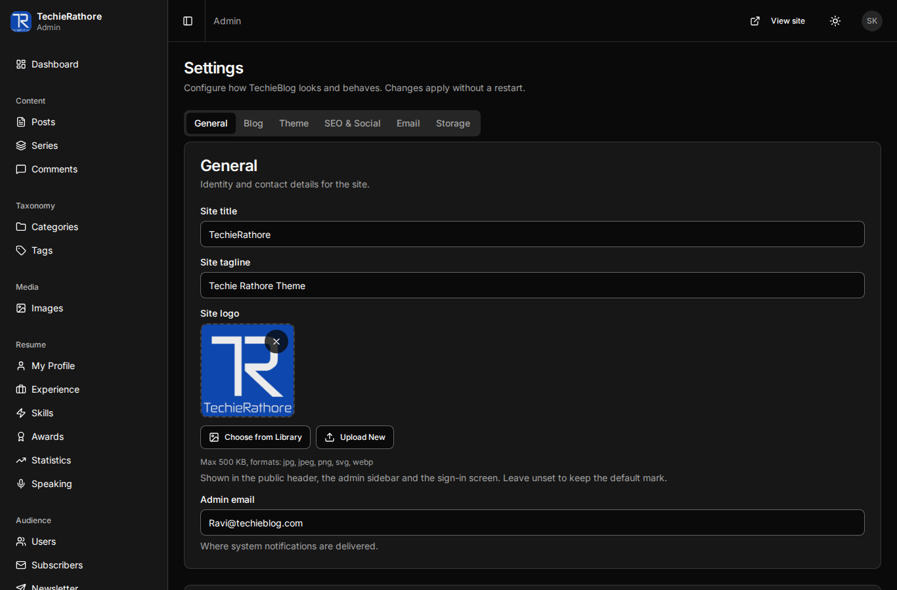

**Runtime:** renders. Seen 2026-11-02, as user 1 (Admin).

**Roles:** `AdminOnly` (`source/BlogUI/Pages/AdminPages/Settings.razor:15`).

**Call chain:** `Settings.razor:SaveSettings` (line 641) → `SiteSettingsService.SaveSettingsAsync` (`source/BlogEngine/Services/SiteSettingsService.cs:260`) → `ISiteSettingRepo.UpsertManyAsync` (`source/BlogEngine/DbAccess/SiteSettingRepo.cs:285`) → site settings rows → `PublishChangeAsync` (`SiteSettingsService.cs:514`) → `InvalidateCache` → `GetSettingsAsync` (line 196, cache key `ServiceCache.SettingsEffectiveKey`, tag `Settings`).

| File and line | Function | Watch | Expected value |
|---|---|---|---|
| `source/BlogUI/Pages/AdminPages/Settings.razor:178-179` | markup binding | `settings.PostsPerPage` | edits the page-local copy only |
| `source/BlogUI/Pages/AdminPages/Settings.razor:624-635` | `OnThemeSelected` | `theme` | `ThemeService.PreviewTheme` (`source/BlogUI/Common/ThemeService.cs:246`); preview only, not saved |
| `source/BlogUI/Pages/AdminPages/Settings.razor:656-666` | `SaveSettings` | `result` | persisted; then `NotifySiteCacheRefreshAsync` (the `CacheNotifier.RefreshAsync` call at line 754) |
| `source/BlogEngine/Common/SiteSettingsMapper.cs:259` | row mapping | `PostsPerPage` | written as one setting row |
| `source/BlogUI/Pages/BlogPages/CategoryArchive.razor:179` | page-size read | `PageSize` | `GetSettingsAsync().PostsPerPage`; same read in `TagArchive.razor:171`, `SearchResults.razor:265`, `Newsletters.razor.cs:97` |

**Calculations on this screen:** none. Public cache: `Settings.razor:711-713` evicts the `Content`, `Taxonomy` and `Settings` tags on "clear cache". The website's `ISiteCacheNotifier` is `NullSiteCacheNotifier` (`source/BlogEngine/Services/NullSiteCacheNotifier.cs:27`), so the post-save "live site" refresh reports NotApplicable. The home page does not read `PostsPerPage`: `Home.razor.cs:34` fixes `LatestArticleCount = 3`.

### Newsletter composer (`/admin/newsletter`)

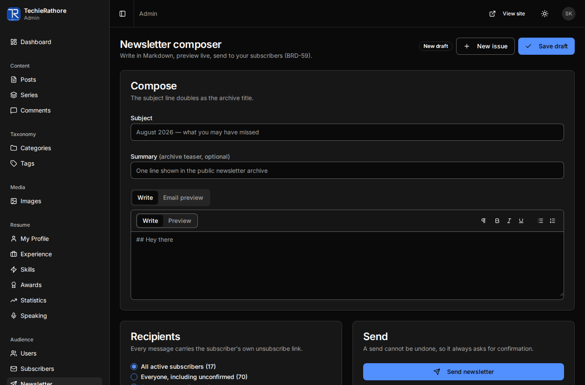

**Runtime:** renders. Seen 2026-11-02, as user 1 (Admin).

**Roles:** `AdminOnly` (`source/BlogUI/Pages/AdminPages/NewsletterComposer.razor:20`).

**Call chain:** Save: `NewsletterComposer.razor.cs:SaveDraftAsync` (line 267) → `NewsletterSvc.SaveDraftAsync` (`source/BlogEngine/Services/NewsletterSvc.cs:173`) → `{unresolved — newsletter save SQL not read}`. Send: `ConfirmSendAsync` (line 367) → `NewsletterSvc.SendAsync` (`NewsletterSvc.cs:267`) → `DispatchAsync` (line 591) → `NewsletterRepo.GetRecipientsAsync` (`source/BlogEngine/DbAccess/NewsletterRepo.cs:422`; `SelectRecipientsSql`, line 109) → `Subscriber`; then per recipient `emailService.SendAsync` (line 655) and a send-history row.

| File and line | Function | Watch | Expected value |
|---|---|---|---|
| `source/BlogUI/Pages/AdminPages/NewsletterComposer.razor.cs:381` | `ConfirmSendAsync` | `dispatch` | `NewsletterService.SendAsync(NewsletterId, BuildAudience())`; page polls history for progress |
| `source/BlogEngine/Services/NewsletterSvc.cs:273-274` | `SendAsync` | `Status` | refuses a newsletter already `sent` |
| `source/BlogEngine/DbAccess/NewsletterRepo.cs:111` | `SelectRecipientsSql` | recipients | `COALESCE(IsConfirmed, FALSE) = TRUE` unless `IncludeInactive`; capped by `MaxRecipients` (`NewsletterRepo.cs:112`) |
| `source/BlogUI/Pages/AdminPages/NewsletterComposer.razor.cs:420-434` | `RefreshAudienceEstimate` | `EstimatedRecipients` | counts `subscribers` (from `GetAllSubscribersAsync`, line 560); advisory only |
| `source/BlogEngine/Services/NewsletterSvc.cs:591-618` | `DispatchAsync` | `report.SentCount`, `FailedCount` | one send per recipient; `TargetedCount` = recipients fetched |

**Calculations on this screen:** `SendProgressPercent` (line 209) = `SentSoFar * 100 / EstimatedRecipients`, capped at 100. `EstimatedRecipients` is the client-side count described above.

### Analytics dashboard (`/admin/analytics`)

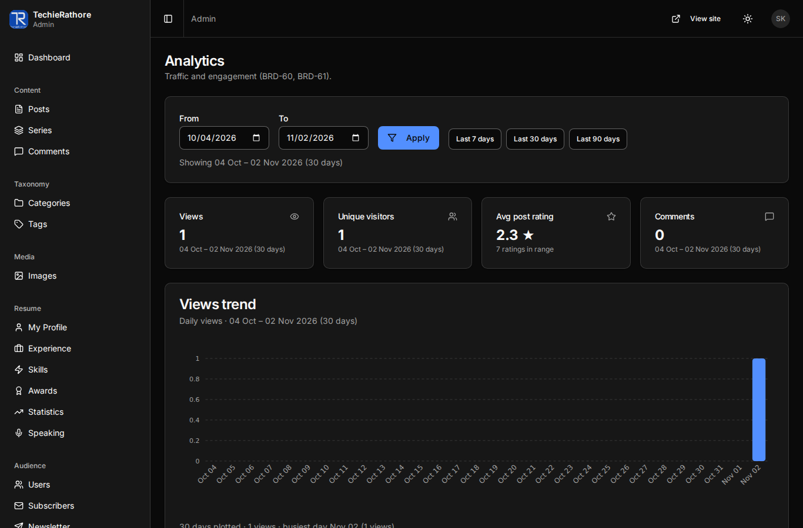

**Runtime:** renders. Seen 2026-11-02, as user 1 (Admin).

**Roles:** `EditorOrAbove` (`source/BlogUI/Pages/AdminPages/AnalyticsDashboard.razor:21`).

**Call chain:** `AnalyticsDashboard.razor.cs:LoadAsync` (line 276) → `AnalyticsSvc.GetSummaryAsync` (`source/BlogEngine/Services/AnalyticsSvc.cs:190`) → `AnalyticsRepo.GetSummaryAsync` (`source/BlogEngine/DbAccess/AnalyticsRepo.cs:334`; `SelectSummarySql`, line 147) → `PostViews`, `BlogPost`, `BlogComment`, `PostRating`. Trend, popular and category calls follow the same shape (`AnalyticsSvc.cs:149`, `:128`, `:169`).

| File and line | Function | Watch | Expected value |
|---|---|---|---|
| `source/BlogUI/Pages/AdminPages/AnalyticsDashboard.razor.cs:290` | `LoadAsync` | `summary` | totals for the applied range |
| `source/BlogUI/Pages/AdminPages/AnalyticsDashboard.razor.cs:291` | `LoadAsync` | `trendPoints` | one point per day, quiet days filled with zero |
| `source/BlogEngine/Services/AnalyticsSvc.cs:221-226` | `OrderRange` | `(RangeStart, RangeEnd)` | end date made inclusive (`end.Date.AddDays(1)`) |
| `source/BlogUI/Pages/AdminPages/AnalyticsDashboard.razor.cs:220-226` | `ApplyPresetAsync` | `appliedFrom`, `appliedTo` | UTC today back `days - 1` |
| `source/BlogUI/Pages/AdminPages/AnalyticsDashboard.razor.cs:293-295` | `LoadAsync` | `popularPosts`, `categoryEngagements` | ranked lists, capped by `PopularPostLimit` and `CategoryLimit` |

**Calculations on this screen:** `CategorySharePercent` (`AnalyticsDashboard.razor.cs:240`) = `TotalViews * 100 / leader`, rounded to one decimal, 0 when there is no leader. `FormatRating` shows `—` for zero ratings.

### Manage profile (`/admin/profile`)

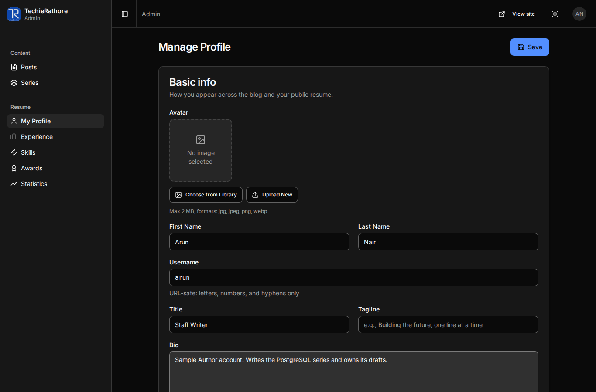

**Runtime:** renders. Seen 2026-11-02, as user 3 (Author).

**Roles:** `Policy = "AuthorOrAbove"` (`source/BlogUI/Pages/AdminPages/ManageProfile.razor:11`). Binds to the caller's own row via the `PrimarySid` claim. No admin user selector exists on this page (see note below the table).

**Call chain:** `ManageProfile.razor.cs:SaveProfile` → `IBlogUserRepo.UpdateAsync` / `UpdateUsernameAsync` / `UpdateResumeFieldsAsync` → `BlogUserRepo` → `BlogUser`

| File and line | Function | Watch | Expected value |
|---|---|---|---|
| `source/BlogUI/Pages/AdminPages/ManageProfile.razor.cs:122` | `LoadProfile` | `CurrentUser` | the signed-in user's `BlogUser` row (`SelectBlogUserById`, `BlogUserRepo.cs:203`) |
| `source/BlogUI/Pages/AdminPages/ManageProfile.razor.cs:256` | `SaveProfile` | `UserRepo.UpdateAsync(CurrentUser)` | names, avatar, bio, Twitter/LinkedIn/GitHub/Instagram written to `BlogUser` (`BlogUserRepo.cs:260`) |
| `source/BlogUI/Pages/AdminPages/ManageProfile.razor.cs:262` | `SaveProfile` | `UpdateUsernameAsync` | username written only when changed; `UPDATE BlogUser SET Username` (`BlogUserRepo.cs:98`) |
| `source/BlogUI/Pages/AdminPages/ManageProfile.razor.cs:277` | `SaveProfile` | `resumeData.CVFilePath` | CV path (picked via `ImagePicker Category="cv"`, `ManageProfile.razor:281`) written by `UpdateResumeFieldsSql` (`BlogUserRepo.cs:500`) |

**Calculations on this screen:** username check (`ManageProfile.razor.cs:182-219`): regex `^[a-zA-Z0-9-]+$`, length 3-50, and availability via `IsUsernameAvailableAsync` only when changed from the original.

Note: the brief names an "admin user selector" for this screen. `ManageProfile.razor` and `.razor.cs` contain no `AllUsers`, `IsAdmin` or `Select`. Only the Experience, Skills, Awards and Stats pages have one. [Certain]

### Manage experience (`/admin/experience`, alias `/admin/experience/{EventId}`)

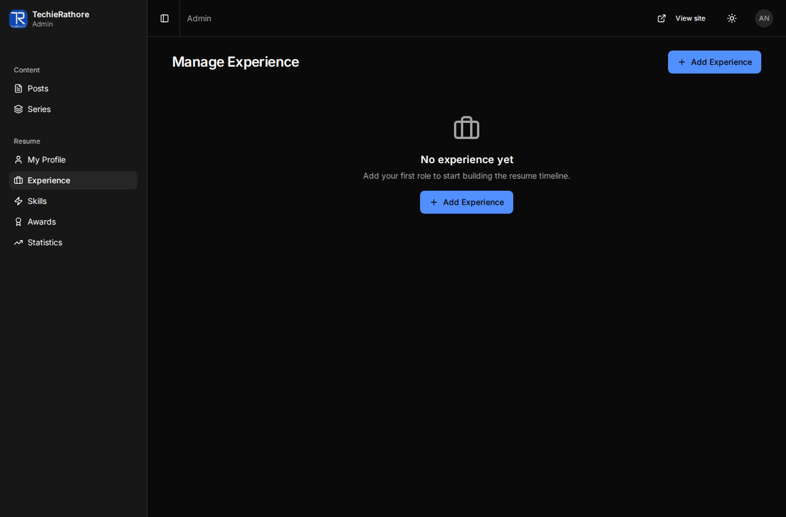

**Runtime:** renders. Seen 2026-11-02, as user 3 (Author).

**Roles:** `Policy = "AuthorOrAbove"` (`source/BlogUI/Pages/AdminPages/ManageExperience.razor:12`). Admins get a user picker (`ManageExperience.razor:40-64`, handler `OnSelectedUserChanged` at `ManageExperience.razor.cs:283`).

**Call chain:** `ManageExperience.razor.cs:LoadData` → `IUserEventRepo.GetByUserAndTypeAsync` → `UserEventRepo` → `userevents`

| File and line | Function | Watch | Expected value |
|---|---|---|---|
| `source/BlogUI/Pages/AdminPages/ManageExperience.razor.cs:219` | `LoadData` | `ExperienceList` | the `Experience`-typed rows for `EffectiveUserId` (`UserEventRepo.cs:159`; ordering comes from its SQL, not verified here) |
| `source/BlogUI/Pages/AdminPages/ManageExperience.razor.cs:425` | `SaveExperience` | `EventRepo.UpdateAsync(CurrentEvent)` | existing row updated (`UserEventRepo.cs:268`, `UPDATE userevents`) |
| `source/BlogUI/Pages/AdminPages/ManageExperience.razor.cs:431` | `SaveExperience` | `EventRepo.InsertToGetIdAsync` | new row inserted (`UserEventRepo.cs:250`, `INSERT INTO userevents`) |
| `source/BlogUI/Pages/AdminPages/ManageExperience.razor.cs:494` | `DeleteExperience` | `EventRepo.DeleteAsync(EventID)` | row removed (`UserEventRepo.cs:285`, `DELETE FROM userevents`) |

**Calculations on this screen:** new-entry `DisplayOrder` = count + 1 (`ManageExperience.razor.cs:300`). `EndDate` is set to today when `IsCurrent` (`:419`). "Reorder" is a free-typed number (`ManageExperience.razor:266-276`, `DisplayOrderText` at `.razor.cs:148`). There are no move-up/move-down controls on this screen.

### Manage skills (`/admin/skills`)

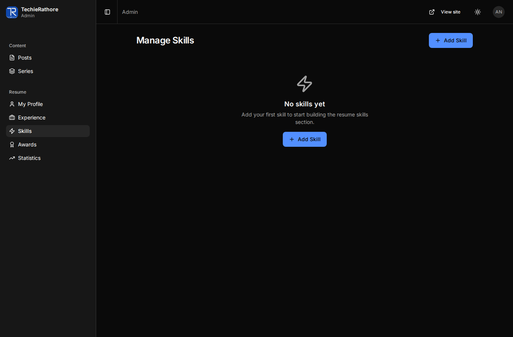

**Runtime:** renders. Seen 2026-11-02, as user 3 (Author).

**Roles:** `Policy = "AuthorOrAbove"` (`source/BlogUI/Pages/AdminPages/ManageSkills.razor:11`). Admin user picker at `ManageSkills.razor:36-56`.

**Call chain:** `ManageSkills.razor.cs:LoadSkills` → `IUserSkillsRepo.GetByUserIdAsync` → `UserSkillsRepo` → `userskills`

| File and line | Function | Watch | Expected value |
|---|---|---|---|
| `source/BlogUI/Pages/AdminPages/ManageSkills.razor.cs:148` | `LoadSkills` | `AllSkills` | the user's skills, grouped by category (`UserSkillsRepo.cs:140`) |
| `source/BlogUI/Pages/AdminPages/ManageSkills.razor.cs:295` | `SaveNewSkill` | `SkillsRepo.CreateAsync(newSkill)` | `INSERT INTO userskills`, `DisplayOrder = max + 1` (`UserSkillsRepo.cs:68`) |
| `source/BlogUI/Pages/AdminPages/ManageSkills.razor.cs:630-660` | `ApplyOrder` | `skill.DisplayOrder` | category block renumbered 1..n, only changed rows written via `SkillsRepo.UpdateAsync` (`UserSkillsRepo.cs:320`) |
| `source/BlogUI/Pages/AdminPages/ManageSkills.razor.cs:418-424` | `DeleteSkill` | `SkillsRepo.DeleteAsync(SkillId)` | row removed (`UserSkillsRepo.cs:337`, `DELETE FROM userskills`) |

**Calculations on this screen:** category order is the minimum `DisplayOrder` of each group (`ManageSkills.razor.cs:475`). Category move calls `SwapCategoryOrder` (`:527`), then `ApplyOrder`.

### Manage awards (`/admin/awards`)

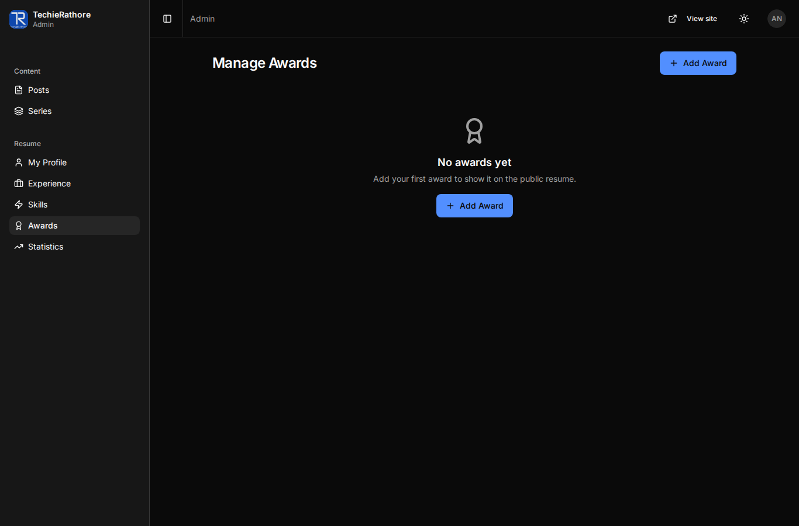

**Runtime:** renders. Seen 2026-11-02, as user 3 (Author).

**Roles:** `Policy = "AuthorOrAbove"` (`source/BlogUI/Pages/AdminPages/ManageAwards.razor:11`). Admin user picker at `ManageAwards.razor:40-45`.

**Call chain:** `ManageAwards.razor.cs:LoadAwards` → `IUserAwardsRepo.GetByUserIdAsync` → `UserAwardsRepo` → `userawards`

| File and line | Function | Watch | Expected value |
|---|---|---|---|
| `source/BlogUI/Pages/AdminPages/ManageAwards.razor.cs:144` | `LoadAwards` | `AllAwards` | the user's awards (`UserAwardsRepo.cs:134`) |
| `source/BlogUI/Pages/AdminPages/ManageAwards.razor.cs:317` | `SaveAward` | `AwardsRepo.CreateAsync(newAward)` | `INSERT INTO userawards`, `DisplayOrder = max + 1` (`UserAwardsRepo.cs:60`) |
| `source/BlogUI/Pages/AdminPages/ManageAwards.razor.cs:434-437` | `SwapAwardOrder` | `award.DisplayOrder` | two rows swapped, both written by `AwardsRepo.UpdateAsync` (`UserAwardsRepo.cs:274`) |
| `source/BlogUI/Pages/AdminPages/ManageAwards.razor.cs:371` | `DeleteAward` | `AwardsRepo.DeleteAsync(AwardId)` | row removed (`UserAwardsRepo.cs:291`, `DELETE FROM userawards`) |

**Calculations on this screen:** `YearRange` is `start-end`, joined in `SaveAward` (`ManageAwards.razor.cs:267-271`). The badge image comes from `ImagePicker Category="awards"` (`ManageAwards.razor:213`).

### Manage speaking (`/admin/speaking`)

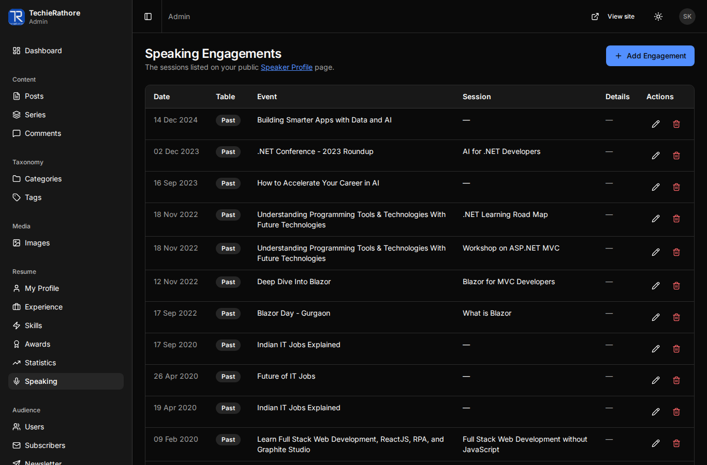

**Runtime:** renders. Seen 2026-11-02, as user 1 (Admin).

**Roles:** `Policy = "EditorOrAbove"` (`source/BlogUI/Pages/AdminPages/ManageSpeaking.razor:15`). Rows belong to the site owner, not the signed-in user.

**Call chain:** `ManageSpeaking.razor.cs:LoadEngagementsAsync` → `IBlogUserRepo.GetSiteOwnerAsync` → `BlogUserRepo` → `BlogUser`, then `IUserEventRepo.GetByUserAndTypeAsync` → `userevents`

| File and line | Function | Watch | Expected value |
|---|---|---|---|
| `source/BlogUI/Pages/AdminPages/ManageSpeaking.razor.cs:134` | `LoadEngagementsAsync` | `siteOwner` | the one `BlogUser` with `IsSiteOwner = TRUE` (`BlogUserRepo.cs:383`, `SelectSiteOwnerSql` at `:88`) |
| `source/BlogUI/Pages/AdminPages/ManageSpeaking.razor.cs:144-146` | `LoadEngagementsAsync` | `engagements` | `EventType = Speaking` rows, newest `EventDate` first (`UserEventRepo.cs:159`) |
| `source/BlogUI/Pages/AdminPages/ManageSpeaking.razor.cs:260` | `SaveEngagement` | `EventRepo.InsertAsync(row)` | new `userevents` row, `UserID` = owner (`UserEventRepo.cs:250`) |
| `source/BlogUI/Pages/AdminPages/ManageSpeaking.razor.cs:369` | `ConfirmDelete` | `EventRepo.DeleteAsync(EventID)` | row removed (`UserEventRepo.cs:285`) |

**Calculations on this screen:** `StartDate` and `IsCurrent` are forced to null and false (`ManageSpeaking.razor.cs:255-256`). `RegistrationUrl` is kept only for upcoming rows (`:249-251`).

### Manage stats (`/admin/stats`)

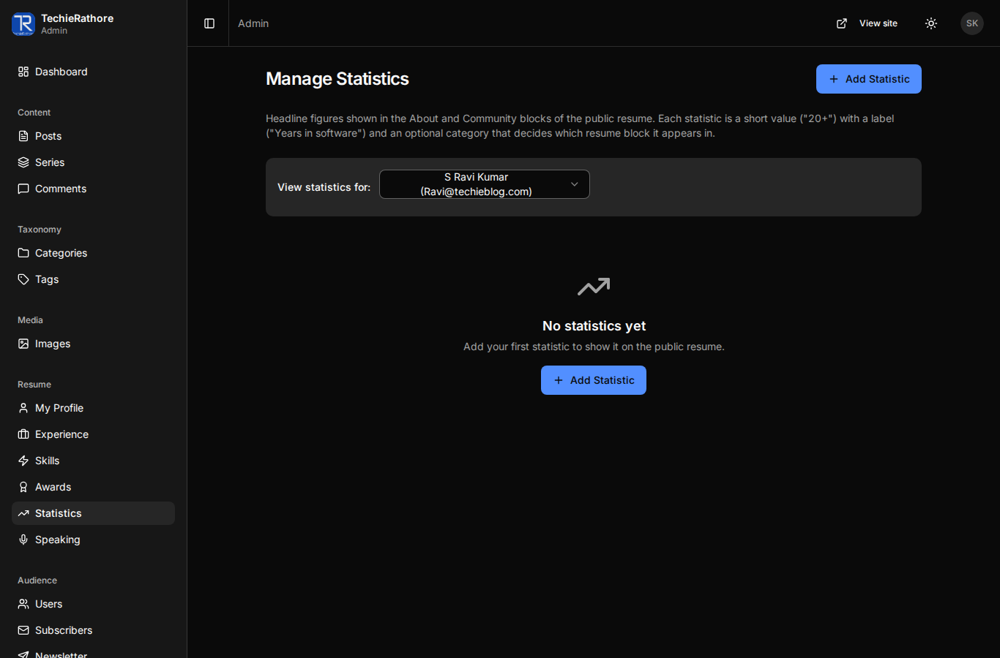

**Runtime:** renders. Seen 2026-11-02, as user 1 (Admin).

**Roles:** `Policy = "AuthorOrAbove"` (`source/BlogUI/Pages/AdminPages/ManageStats.razor:14`). Admin user picker at `ManageStats.razor:49-54` (`ValueChanged` → `OnSelectedUserChangedAsync`, `ManageStats.razor.cs:227`).

**Call chain:** `ManageStats.razor.cs:LoadStatsAsync` → `UserStatsSvc.GetStatsForUserAsync` → `IUserStatsRepo.GetByUserIdAsync` → `UserStatsRepo` → `userstats`

| File and line | Function | Watch | Expected value |
|---|---|---|---|
| `source/BlogUI/Pages/AdminPages/ManageStats.razor.cs:216` | `LoadStatsAsync` | `AllStats` | the selected user's stats (`UserStatsSvc.cs:116`, `UserStatsRepo.cs:132`) |
| `source/BlogUI/Pages/AdminPages/ManageStats.razor.cs:305` | `SaveStatAsync` | `result` | `UserStatsSvc.SaveStatAsync` → `CreateAsync` (`UserStatsSvc.cs:232`, INSERT at `UserStatsRepo.cs:60`) or `UpdateAsync` (`UserStatsRepo.cs:295`) |
| `source/BlogUI/Pages/AdminPages/ManageStats.razor.cs:441` | `MoveStatAsync` | `ReorderStatsAsync` | renumbered 0..n (`UserStatsSvc.cs:384`) |
| `source/BlogUI/Pages/AdminPages/ManageStats.razor.cs:374` | `DeleteStatAsync` | `DeleteStatAsync(StatId)` | row removed (`UserStatsSvc.cs:334`, `UserStatsRepo.cs:313`, `DELETE FROM userstats`) |

**Calculations on this screen:** new `DisplayOrder` = max + 1 (`ManageStats.razor.cs:463`). Move up/down swaps positions in the ordered list (`:438-439`) and reorders through the service.

### BlogApp connection setup (`/blogapp/connection`, alias `/blogapp/connection/settings`)

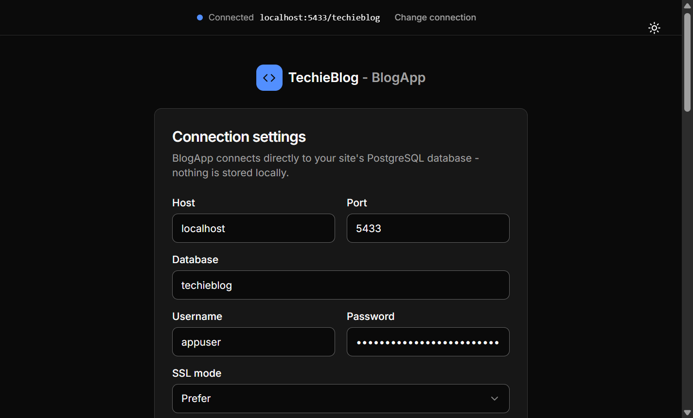

**Runtime:** renders. Seen 2026-11-02, BlogApp desktop head driven over its own WebView2 DevTools port: "Connection settings".

**Roles:** public within BlogApp. No `[Authorize]` attribute (`source/BlogApp/Components/Pages/ConnectionSetup.razor:17-18`).

**Call chain:** `ConnectionSetup.razor.cs:SaveAndContinue` → `ConnectionProbe.TestAsync` → Npgsql open, then `IConnectionStore.SaveAsync` → `ConnectionStore` → SecureStorage, DPAPI file fallback (no SQL table)

| File and line | Function | Watch | Expected value |
|---|---|---|---|
| `source/BlogApp/Components/Pages/ConnectionSetup.razor.cs:288` | `TestMediaLocation` | `MediaLocationProbe.TestAsync(Settings)` | Sftp → `TestSftpAsync`, Folder → `TestFolderAsync`, None → "nothing to test" (`source/BlogApp/Services/MediaLocationProbe.cs:127-147`) |
| `source/BlogApp/Components/Pages/ConnectionSetup.razor.cs:329` | `TestConnection` | `probeResult` | read-only probe; success message verbatim (`source/BlogApp/Services/ConnectionProbe.cs:91`) |
| `source/BlogApp/Components/Pages/ConnectionSetup.razor.cs:385` | `SaveAndContinue` | `Settings.HasUsableSecrets()` | JWT key ≥ `AppSecrets.MinimumJwtSigningKeyLength`, encryption key ≥ `MinimumEncryptionKeyLength` (`source/BlogApp/Services/ConnectionSettings.cs:459-464`) |
| `source/BlogApp/Components/Pages/ConnectionSetup.razor.cs:402` | `SaveAndContinue` | `ConnectionStore.SaveAsync(Settings)` | written encrypted (`source/BlogApp/Services/ConnectionStore.cs:175-179`, `DataProtectionScope.CurrentUser`) |
| `source/BlogApp/Components/Pages/ConnectionSetup.razor.cs:443` | `ForgetConnection` | `ConnectionStore.ClearAsync()` | stored credential removed, app restarts to setup |

**Calculations on this screen:** `SftpPort` defaults when blank (`ConnectionSetup.razor.cs:260`). A non-numeric port becomes 0 (`:195`). `IsBusy` blocks all actions.

### BlogApp start (`/blogapp/start`)

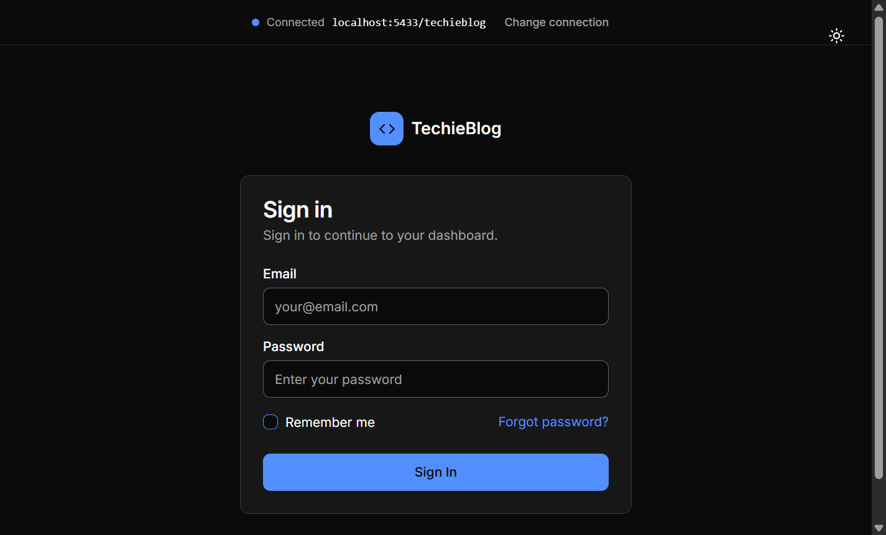

**Runtime:** redirects. Seen 2026-11-02, BlogApp desktop head, signed out: lands on `/login` as designed (screenshot is the destination).

**Roles:** none. Any state is accepted. Anonymous goes to `/login`, signed-in goes to the role landing route (`source/BlogApp/Components/Pages/DesktopStart.razor:22`).

**Call chain:** `DesktopStart.razor:OnAfterRenderAsync` → `ResolveDestinationAsync` → `AuthenticationStateProvider` → `RoleLandingRoutes.ResolveFor` (no data access, no SQL)

| File and line | Function | Watch | Expected value |
|---|---|---|---|
| `source/BlogApp/Components/Pages/DesktopStart.razor:79` | `OnAfterRenderAsync` | `hasNavigated` | guard so the redirect runs once, on first render only |
| `source/BlogApp/Components/Pages/DesktopStart.razor:113-116` | `ResolveDestinationAsync` | `state.User.Identity.IsAuthenticated` | false → `AnonymousDestination` (`/login`, `:57`) |
| `source/BlogApp/Components/Pages/DesktopStart.razor:121-122` | `ResolveDestinationAsync` | `role` | `RoleLandingRoutes.ResolveFor(role)`; a blank role maps to the public home |
| `source/BlogApp/Components/Pages/DesktopStart.razor:88` | `OnAfterRenderAsync` | `NavigationManager.NavigateTo(destination, replace: true)` | replaces the history entry, so Back does not return here |

**Calculations on this screen:** role to route mapping only (`RoleLandingRoutes.ResolveFor`). Any exception falls back to `/login` (`DesktopStart.razor:124-127`).

---

## Cross-cutting flows

### Sign-in

**Call chain:** `LoginPage.razor:26` EditForm → `LoginPage.razor.cs:ValidateUser` (`:136`) → `TechieBlog/Services/AuthService.cs:LoginAsync` (`:89`, encrypt `:91-92`) → `AuthSvc.AppLoginAsync` (`BlogEngine/Services/AuthSvc.cs:153`) → `AuthenticateAsync` (`:270`) → `PasswordHasher.Verify` (`BlogModel/Common/PasswordHasher.cs:163`) → `AuthSvc.IssueSessionAsync` (`AuthSvc.cs:383`) → `GenerateJWToken` (`:687`) → `userlogins` insert (`UserLoginRepo.cs:52`) → decrypt `TechieBlog/Services/AuthService.cs:99` → `LoginPage.razor.cs:161` `CustomAuthStateProvider.MarkUserAsAuthenticated` (`source/BlogUI/Common/CustomAuthStateProvider.cs:324`) → local storage `AppConstants.AccessKey` / `RefreshKey` (`source/BlogModel/Common/AppConstants.cs:89`, `CustomAuthStateProvider.cs:326-327`) → session cookie (`:328`) → `NotifyAuthenticationStateChanged` (`:331`) → `LoginPage.razor.cs:162` `ResolveDestination` (`:188`)

| Break point (file and line) | What breaks | Result |
|---|---|---|
| `AuthService.cs:91-92` encrypt, `AuthSvc.cs:157-158` decrypt | key mismatch between host and engine | `AppLoginAsync` gets null credentials and refuses; visitor sees "Invalid email or password." |
| `AuthSvc.cs:161` throttle | account locked | refused before the password check; the attempt is still audited (`:166`) |
| `AuthSvc.cs:280` and `:286-300` | wrong password, unknown address, deactivated (`IsConfirmed` false) | all return the same null; an unconfirmed account is only refused after the password check |
| `IssueSessionAsync` `AuthSvc.cs:387` | `userlogins` insert fails | exception; `ValidateUser` catch shows "An error occurred during login." (`LoginPage.razor.cs:166`) |
| `CustomAuthStateProvider.cs:206` read on later circuits | JS interop unavailable (static prerender) | `ReadPrerenderIdentity` (`:229`, `:434`) uses the server cookie identity |
| `CustomAuthStateProvider.cs:263` `ResolveSessionUserAsync` | access token expired | `AuthSvc.RefreshTokenAsync` (`:293`) reissues from the `UserLogin` row; if that fails the session ends |

**Signature warning [Certain]:** `AuthSvc.cs:49-52` and `:428-436` state the JWT signature is never verified on the way in. Session validity is the exact-token lookup in `UserLogin` (`GetUserByTokenAsync`, `AuthSvc.cs:441-476`). A claim read from the token must never be trusted.

### Scheduled publishing

**Schedule write:** `ManagePost.razor.cs:HandleSchedule` (`:772`, future check `:784`, UTC `:838`) → `BlogSvc.SchedulePostAsync` (`source/BlogEngine/Services/BlogSvc.cs:900`, sets `ScheduledPublishOn`, forces `Published = false`, `:908-909`) → `SavePostAsync` → `BlogPostRepo.UpdateAsync` (`BlogPostRepo.cs:218-232`).

**Hosted service:** `source/BlogEngine/Services/ScheduledPostPublisher.cs:64` (`BackgroundService`), registered at `source/BlogEngine/BlogSvcInitializer.cs:201` with `AddHostedService`. `checkInterval` = 1 min (`:68`); `ExecuteAsync` at `:105`; 10 s startup delay (`:110`); loop and `Task.Delay(checkInterval)` at `:112-123`.

**Tick:** `PublishDuePosts` (`:151`) opens a scope (`:155`) → `BlogSvc.GetDueScheduledPostsAsync` (`BlogSvc.cs:871`, `DateTime.UtcNow`) → `BlogPostRepo.GetDueScheduledPostsAsync` (`BlogPostRepo.cs:794`) → `SelectDueScheduledSql` (`:306-316`: `Published = FALSE AND ScheduledPublishOn <= @Now`) → per post `:172-177`: `Published = true`, `PublishedOn = ScheduledPublishOn`, `ScheduledPublishOn = null`, `blogSvc.UpdatePostAsync(post)` (`BlogSvc.cs:571`).

| Break point (file and line) | What breaks | Result |
|---|---|---|
| `ScheduledPostPublisher.cs:118-121` | an exception escapes a tick | logged; loop continues (`:123`) |
| `ScheduledPostPublisher.cs:192-197` | one post fails to save | logged; the rest of the batch still publishes |
| `ScheduledPostPublisher.cs:200-203` | the due-list read fails | logged; `BlogSvc.GetDueScheduledPostsAsync` returns empty (`BlogSvc.cs:877-880`) |
| `ScheduledPostPublisher.cs:31-39` | two host instances | no cross-process lock; both tick; second finds nothing due, but a row can be double-written |
| `BlogPostRepo.cs:307-309` projection | scheduled part of a series | `SeriesId` and `SeriesPartNumber` are not selected, then written back as NULL (see Defects, D1) |

### Configuration, logging, errors

- AppDbConString read: `source/TechieBlog/Program.cs:287` (falls back to `ConnectionStrings:Default`, `:288`; throws `:290` if both missing). BlogApp: `source/BlogApp/MauiProgram.cs:60`.
- DbUp migration at startup: `source/TechieBlog/Program.cs:547-561` (`new BlogDbSvc().UpgradeDatabase`, `:552`); engine `source/BlogDb/BlogDbSvc.cs:52` (`DeployChanges.To`). Scripts in `source/BlogDb/PostgresScripts/`. A failed migration logs an error but the host still starts (`:555-558`).
- Required secrets check: `source/TechieBlog/Program.cs:235` `AppSecrets.Initialise(builder.Configuration)`; implementation `source/BlogModel/Common/AppSecrets.cs:180`. Missing value throws, host exits 1 (`source/TechieBlog/Program.cs:833-838`). BlogApp equivalent: `ConnectionSettings.cs:459-464`.
- Serilog: bootstrap logger `source/TechieBlog/Program.cs:49`; `Log.Logger` built `:141`; `builder.Host.UseSerilog()` `:253`; request logging `:665`. File sink `:126`. Unobserved task exceptions: `source/TechieBlog/Observability/GlobalExceptionLogging.cs:115`. BlogApp: `source/BlogApp/MauiProgram.cs:173-179`.
- Global error handling: `source/TechieBlog/Program.cs:578` `UseExceptionHandler("/Error")` (non-Development); `:620` status-code re-execute to `NotFoundPage`. Blazor error boundary: `source/BlogUI/Routes.razor:19`; BlogApp: `source/BlogApp/Components/Routes.razor:21`.
- Content cache: `source/BlogEngine/Services/MemoryCacheService.cs:96` default lifetime 10 minutes (absolute, `:168`), tag-invalidated in-process only. Public reads tagged `CacheTags.Content` in `source/BlogEngine/Services/BlogSvc.cs:44-47`. Output cache `PublicListing` expires 5 minutes (`source/TechieBlog/Program.cs:373`). The website's cross-process notifier is a no-op (`source/TechieBlog/Program.cs:534`). Net effect: a row written directly in psql stays hidden from cached listings until the 10-minute entry expires or the host restarts. [Likely]
- DI registration of main services: `source/BlogEngine/BlogSvcInitializer.cs:94-205` (repos transient with `dbConnectionString`; `AuthSvc` `:139`, `BlogSvc` `:143`, `UserStatsSvc` `:180`, `ICacheService` singleton `:112`, `IBlogImageService` scoped `:186`). Called from `source/TechieBlog/Program.cs:295`. Host-only registrations: `source/TechieBlog/Program.cs:301` (cache decorator), `:346` (output cache), `:522` (`IAuthService`), `:534` (`ISiteCacheNotifier`).

## Known issues

Found while mapping on 2026-11-02. "By reading" means read in the code, not reproduced; each needs `*triage-issues` before a fix.

- **Posts-list search and row Delete crash the page for an Admin (reproduced 5 of 5).** User 1 → `/BlogsList` → type in `posts-search`, or click a row's Delete → "Something went wrong". `RuntimeBinderException` in TrBlazeUI 2.2.1 `SelectValue.GetSelectedText`, from the bulk-action Select (`BlogsList.razor:265`). TR-077. REQ-UI-017 (now Needs re-verify).
- **D3 — an Author could open and edit any post — FIXED 2026-11-05.** `ManagePost.razor.cs` and `PreviewPost.razor` loaded by id with no owner check, and saving handed the post to whoever saved it. Both now apply `PostAccess.CanEdit` (BlogModels): an Admin or Editor edits any post, anyone else only their own, and an existing post keeps its owner. Proof: `tests/verify/triage-20261105-post-ownership.spec.ts`, `tests/unit/Security/PostAccessTests.cs`. REQ-UI-016.
- **The same `Select` crash once in the post editor**, 8 s after a publish. Not reproduced there. TR-077. REQ-UI-016.
- **D1 — scheduled publish drops series membership** (by reading). `BlogPostRepo.cs:307-309` omits `SeriesId`/`SeriesPartNumber`; written back as NULL at `:229-230`. REQ-FN-016.
- **D2 — Save Draft keeps the schedule** (likely). `ManagePost.razor.cs:688`, `BlogSvc.cs:694-702`. REQ-FN-016.
- **D6 — the title overwrites a hand-typed slug on a new post** (by reading). `ManagePost.razor.cs:475-478`. REQ-UI-016.
- **Search filters do nothing** (by reading). Category, date and sort are bound but not applied (`SearchResults.razor:43-77`, `:261-291`); rating hard-coded 0 (`:289`). REQ-UI-011.
- **Post-page tag links can miss the archive** (by reading). `PostView.razor:304` builds the slug with `GetSlug` (`:749-757`), not `SlugGenerator.GenerateSlug`; "ASP.NET" → `/tag/asp.net`, stored as `aspnet`. REQ-UI-007.
- **RSS page Copy button never copies** (by reading), yet shows "copied". `RssFeed.razor:164-174`. REQ-UI-046.
- **D7 — "Remember me" is never read** (by reading). `LoginPage.razor:65`, `:96`. REQ-UI-001.
- **D8 — the reset-success message is never shown** (by reading). `ResetPasswordPage.razor:190` sends `?message=`; nothing reads it. REQ-UI-003.
- **Dashboard "Pending Comments" counts rejected and spam** (by reading). `AdminCountsRepo.cs:77` counts `Published = FALSE`. REQ-FN-036.
- **D4, D5 — series admin is not owner-scoped; a stale series URL creates a new series** (likely). `SeriesList.razor:258`, `SeriesSvc.cs:482-600`; `ManageSeries.razor.cs:51-56`. REQ-UI-024.
- **Award up/down does nothing when two awards share an order number** (likely). `ManageAwards.razor.cs:432-434`. REQ-UI-039.
- Minor, by reading: Publish Now leaves `ScheduledPublishOn` set (`BlogSvc.cs:719-737`); Add user writes the user and its password in two calls with no transaction (`AuthSvc.cs:750`, `:755`); the comment queue loads each comment's post one by one (`CommentsList.razor:384`); a NULL `Subscriber.IsConfirmed` shows Active but is excluded from counts and sends (`SubscriberRepo.cs:59` vs `AdminCountsRepo.cs:83`).
- `About.razor:81-98` links GitHub, Twitter and LinkedIn to the sites' home pages, not the owner's profiles.
- Open checklist rows: REQ-UI-025, REQ-FN-031, REQ-UI-047 are `Needs re-verify`.
